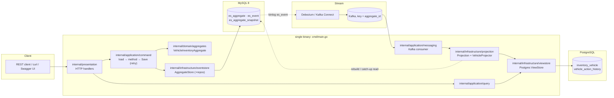

# 02 — Architecture Review

## 1. Target architecture: verdict

The target stays: a Go modular monolith with ES/CQRS, MySQL event store → Debezium → Kafka → PostgreSQL read model. It is built **on the existing framework** rather than beside it.

Scenario B alone does not need this stack. One Postgres with a synchronous projection would meet every PDF requirement. The stack is a **self-imposed** extension (01 §1), so the System Design Document must justify it (R10).

One choice has a concrete technical justification worth recording:

- **Debezium (binlog) instead of polling `es_event`.** A poller reading `WHERE id > :last` can silently skip events. `AUTO_INCREMENT` values are assigned at insert time, not commit time, so a transaction holding `id=101` can commit after the poller has already seen `102`. The binlog is written in **commit order**.

## 2. Target architecture mapped onto existing packages

The process layout is unchanged in intent (D7): one image, `cmd/main.go` grows subcommands `api`, `projector`, `migrate` and `rebuild`. It is currently a `Hello, World!` placeholder.

## 3. Current architecture inventory (working tree at `dde142b`, source identical to `7d04502`)

Baseline verification (run 2026-10-29, Go 1.26.5): `go vet ./...` is clean. `go test ./...` passes **17 tests in 3 packages** (6 in `package/eventsourcing`, 1 in `internal/domain/aggregates`, 10 in `internal/infrastructure/eventstore`), with and without `-race`. All event-store tests run on **SQLite** (in-memory). No test touches MySQL.

| Component | Path | State | Evidence / notes |
|---|---|---|---|
| `AggregateRoot` (ID, type, version/baseVersion, pending events, `ApplyChange`, `LoadFromHistory` with contiguity check, `Update`) | `package/eventsourcing/aggregate_root.go` | **Existing, tested** | 5 tests: pending versions, rejected event not pending, update, replay gap/apply error/id mismatch, `SetID` |
| `Aggregate` / `BaseAggregate` interfaces (`Transition`, `RegisterEvents`) | `package/eventsourcing/aggregate.go` | **Existing** | |
| `Event` envelope (`ID int64`, `AggregateID`, `Version`, `EventType`, `Data`, `Metadata`, `CreatedAt` unix s) | `package/eventsourcing/event.go` | **Existing**. No schema version or aggregate type field. | |
| Serializer registry (key `<AggregateStructName>_<EventStructName>`, factory per pointer type, JSON) | `package/eventsourcing/serializer.go` | **Existing, tested** | 1 test |
| `AggregateStore` (`Get` with snapshot + replay, `Save` in one tx: create-if-missing → CAS → append → optional snapshot) | `internal/infrastructure/eventstore/aggregate_store.go` | **Existing, tested on SQLite** | 10 tests: multi-event save, rollback, OCC, DB error ≠ conflict, replay errors, snapshots, interval change, metadata, guards, duplicate version |
| Repos: `EventStore` interface, `aggregateRepo` (CAS, snapshot), `eventRepo` (append/get), `WithTransaction` | `internal/infrastructure/eventstore/repos/` | **Existing**. MySQL-specific SQL branches are present (`INSERT IGNORE`) but **never executed** in tests. | |
| Schema + `Migrate` (`CREATE TABLE IF NOT EXISTS`, MySQL `schema.sql` / SQLite inline) | `repos/schema.go`, `repos/schema.sql` | **Existing, unversioned** | |
| `VehicleInventoryAggregate` with 5 registered events and `Transition` dispatch | `internal/domain/aggregates/` | **Partial**: appliers are no-ops, there are no state fields, no command methods and no invariants | 1 test pins event type names |
| Event structs `VehicleStockedEvent` … `VehicleActionCancelledEvent` | `internal/domain/events/` | **Partial**: empty structs, no fields | |
| Domain errors | `internal/domain/errors.go` | **Partial**: `ErrUnknownEventType` only | |
| `Projection` pipeline (stages, `errgroup` for multi-projector stages) | `internal/infrastructure/projection/projection.go` | **Existing, untested** | |
| `Projector` interface, `VehicleProjector`, `OutboxProjector` | `projection/projectors/` | **Stubs** (return nil) | |
| `ViewStore` interface (`Save(ctx, ev)`) | `internal/infrastructure/viewstore/` | **Stub** (interface only) | |
| Application `command`, `query`, `messaging`; `presentation`; `cache`; `package/redis` | | **Empty** (package clause only) | |
| `cmd/main.go` | | Placeholder | |
| MySQL driver, Postgres driver, Kafka client, HTTP server, migrations tool, OpenAPI, Compose, Dockerfile, Makefile | | **Missing**. `Dockerfile`, `Makefile`, `docker-compose.yaml`, `.env` and `.dockerignore` exist but are **empty**. | |

## 4. Decisions in the previous docs that contradicted the code

| # | Previous statement (`dde142b`) | What the code actually shows | Revised position |
|---|---|---|---|
| C1 | "Replace GORM + SQLite with `database/sql` + `pgx`" (old D1) | GORM is used only as a thin SQL executor with raw SQL, and it works. The real gap is that **no test runs on MySQL**, not GORM itself. | **Keep GORM.** Add `gorm.io/driver/mysql` and MySQL integration tests. Postgres for the read side is new code, and the driver choice there is open (07 §6). |
| C2 | "Drop snapshots" | Snapshots are implemented and tested (restore, later events, interval change). A probe on 2026-10-29 showed **silent state loss** when an aggregate keeps state in unexported fields without custom JSON (04 §7). | **Keep the capability, disable it for `VehicleInventoryAggregate`** (interval 0, supported today). Re-enable only with a JSON round-trip test. |
| C3 | "Drop the `es_aggregate` version row; the unique key alone suffices" | The CAS row also gives the **aggregate type check** on load and save (`ErrAggregateTypeMismatch`, tested), and it is the mechanism the OCC test exercises. | **Keep the CAS + unique key** (D15). Verify MySQL behaviour (H1) before changing anything. |
| C4 | "Replace reflection-derived event names with string constants" | Names are derived from Go struct names, and the existing aggregate test already **pins** them (`VehicleStockedEvent`, …). | **Keep.** Treat the struct names as frozen (D12). An optional `EventName()` override can be added backward-compatibly if a rename is ever needed. |
| C5 | "Replace the serializer registry with a switch decoder" | The registry works and is tested. Schema versioning can be layered on it. | **Keep**, and add a schema version to the envelope (D13). |
| C6 | "Drop the outbox projector, Redis and cache" | They are stubs and harmless when unwired. | **Keep files, do not wire them.** Removal is a separate, explicit decision. |
| C7 | "Parallel `errgroup` projectors break atomicity → single projector" | With one projector per stage the pipeline already takes the non-`errgroup` path (`len(stage) == 1`). | **Keep the pipeline.** Run it inside one ViewStore transaction (05 §4). Multi-projector stages are not used for the read model. |
| C8 | Event table `event_store` with `event_id CHAR(36)`, `aggregate_version`, `payload JSON`, `occurred_at DATETIME(6)` | The real table is `es_event(id BIGINT AI, aggregate_id, event_type, version, data TEXT, metadata TEXT, created_at BIGINT)` | All docs now describe the **real** schema plus **additive** changes only (04). |
| C9 | Domain written as pure decide/evolve functions on a new `Vehicle` type | The framework's pattern is: command method validates → `ApplyChange` → `Transition` mutates and records a pending event | **Use the framework's pattern** on `VehicleInventoryAggregate` (03). |
| C10 | Package layout `internal/inventory/{domain,app,…}`, `package/` folded into `internal/` | Existing layout `internal/{domain,application,infrastructure,presentation}` + `package/eventsourcing` | **Keep the existing layout** and fill in the empty packages (07 §1). |
| C11 | Testcontainers for all integration tests | The dev machine runs rootless Podman with no active Docker-compatible socket (checked 2026-10-29). Testcontainers would need extra setup. | MySQL/Postgres integration tests connect via a DSN env var to the Compose services, behind the `integration` build tag. Testcontainers is optional. |

## 5. Reuse plan

| Item | Plan | Change size |
|---|---|---|
| `AggregateRoot`, `Aggregate`, `Event` | **Reuse.** Extend `Event` with `AggregateType string` and `SchemaVersion int` (zero value = 1) | additive fields |
| Serializer | **Reuse as-is** | none |
| `AggregateStore.Get/Save` | **Reuse.** Construct with `NewAggregateStoreWithSnapshotInterval(repos, 0)` for vehicles. Map MySQL deadlock/lock-timeout to `ErrConcurrencyConflict` if H1 is confirmed. | small |
| `repos.EventStore` + `WithTransaction` | **Reuse.** Write the new columns in `Append`. Add `ReadAll(afterID, limit)` and `ReadStream(id, from, to)` read methods for rebuild/catch-up. | additive methods |
| `repos.Migrate` | **Minimally refactor** into versioned, embedded, numbered scripts recorded in a `schema_migrations` table. Script `0001` equals today's DDL (`IF NOT EXISTS`, so existing DBs are adopted). | small |
| `VehicleInventoryAggregate`, event structs, domain errors | **Extend:** state fields, command methods, appliers, payload fields, error sentinels | main domain work |
| `Projection` / `Projector` | **Reuse.** Narrow change: the `Projector.Handle` signature gains a transaction-scoped `viewstore.ViewStore` argument (05 §4.1) | signature change on 2 stubs |
| `ViewStore` | **Extend** the interface with `WithTransaction`, `AggregateVersion`, and read-model writes and queries. Postgres implementation. | new implementation |
| `application/{command,query,messaging}`, `presentation`, `cmd` | **Fill in** the existing empty packages | new code in existing packages |
| `OutboxProjector`, `cache`, `package/redis` | **Leave untouched and unwired** | none |

## 6. Risks and mitigations

| # | Risk | Impact | Mitigation |
|---|------|--------|------------|
| R1 | Debezium keys messages by primary key (`es_event.id`) by default, so events of one vehicle land on different partitions | Read-model corruption | `message.key.columns = <db>.es_event:aggregate_id`. A test asserts key = `aggregate_id`. Gap detection halts if this is ever wrong. |
| R2 | Debezium/Kafka setup eats the schedule | Late E2E | Business E2E first via the rebuild/catch-up reader (D14). Debezium time-boxed (07). Fallback: polling transport reusing `ReadAll` (with the commit-order caveat in §1 documented). |
| R3 | Debezium type mapping: `TEXT` → string, `BIGINT` → number | Decode bugs | The current schema has no `JSON`, `DATETIME` or `BINARY` columns, so mapping is simple. A golden-message test covers it. |
| R4 | Debezium initial snapshot re-emits rows | Duplicates | The projector is idempotent by version |
| R5 | Schema-history topic with default retention | Connector cannot restart | Create it with `retention.ms=-1` |
| R6 | Read-after-write lag | UX / demo | Command responses return write-side state + `version`. `projection_lag_seconds` metric. |
| R7 | RAM footprint (MySQL + Postgres + Kafka + Connect ≈ 3–4 GB) | Reviewer machine | Memory limits. Observability backends opt-in. |
| R8 | Dealership time zone needed on both sides | Duplication | Reference data seeded in both DBs |
| R9 | Unknown event type/version in the projector | Halt | Halt the partition, never skip. Deploy the projector first. |
| R10 | The stack looks heavier than the PDF problem | Perceived judgement | The SDD shows the simplest viable design first and justifies each extra |
| R11 | **SQLite tests hide MySQL behaviour** (error codes, locking, `INSERT IGNORE`, DDL) | False confidence | MySQL integration tests for every `AggregateStore` behaviour already tested on SQLite, plus concurrency tests (Phase 1) |
| R12 | **H1, unverified hypothesis:** on MySQL, concurrent saves to an existing aggregate each run `INSERT IGNORE` on `es_aggregate` (which takes a shared lock on the duplicate row) and then `UPDATE` it (exclusive lock). That can deadlock (error 1213) instead of producing a clean CAS conflict. | Conflicts surface as 500s | Phase 1 concurrency test on MySQL. If confirmed: map 1213/1205 → `ErrConcurrencyConflict`, and/or skip `CreateIfNotExist` when `BaseVersion() > 0`. |
| R13 | Snapshot state loss for aggregates with unexported state (verified, 04 §7) | Silent corruption | Interval 0 for vehicles. Re-enable only with a round-trip test. |
| R14 | `CreatedAt` has second precision (`time.Now().Unix()`) | Coarse ordering and lag metric | Ordering uses `version`/`id`, not time. Lag metric resolution of 1 s is accepted. Change to ms only by explicit decision (open). |

## 7. Architecture decision records (summary)

| ADR | Decision | Alternatives rejected | Trade-off accepted |
|-----|----------|----------------------|--------------------|
| 1 | ES only for `VehicleInventoryAggregate`. Dealership is reference data. | ES dealerships | Seed duplication |
| 2 | OCC = `es_aggregate` CAS inside the save tx + unique `(aggregate_id, version)` as defence in depth. The server retries on conflict (re-load, re-validate) up to 3 times when no `If-Match` is sent. | Pessimistic locking; unique key only | One extra row write per save; H1 to verify |
| 3 | CDC topic keyed by `aggregate_id` | Single partition | Connector config must be right (R1) |
| 4 | Projection state + per-aggregate version in one Postgres tx | Kafka offsets only | Offsets-in-PG optional (D5) |
| 5 | Rebuild reads MySQL `es_event`, never Kafka | Replay from Kafka | Projector holds read-only MySQL credentials |
| 6 | Aging computed at query time | Stored flag + job | Business date computed per request |
| 7 | Keyset pagination | OFFSET | No random page access |
| 8 | stdlib `net/http` + hand-written OpenAPI + contract test | Frameworks, codegen | Kept in sync by a test |
| 9 | Aggregate IDs are UUIDv7 strings generated by the app (fits `es_aggregate.id VARCHAR(255)`) | Auto-increment | — |
| 10 | GORM stays for the write side (D1) | `database/sql` rewrite | GORM indirection, already contained to raw SQL |
| 11 | Snapshots kept, disabled for vehicles (D2) | Delete / enable blindly | Unused code path retained |

## 8. Libraries

Existing: `gorm.io/gorm`, `gorm.io/driver/sqlite` (unit tests), `golang.org/x/sync`.
To add, each when its phase starts: `gorm.io/driver/mysql` (Phase 1), a Postgres driver (open: `gorm.io/driver/postgres` for consistency with the write side, or `pgx/v5` directly; 07 §6), `twmb/franz-go` (Kafka), `google/uuid` (v7 IDs), `log/slog` (stdlib), OpenTelemetry, `prometheus/client_golang`, `getkin/kin-openapi` (contract test only).
