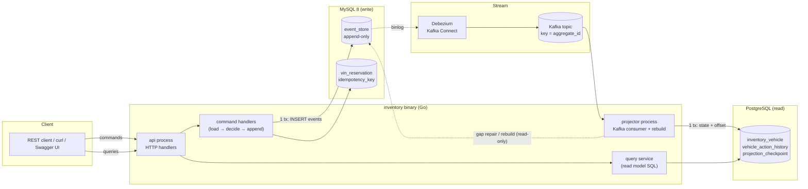

# 02 — Architecture Review

## 1. Proposed architecture: verdict

The proposed stack (Go modular monolith, ES/CQRS, MySQL event store → Debezium → Kafka → Postgres projection) is **kept**. Scenario B alone does not need it. A single Postgres with a synchronous projection would meet every business requirement. The brief, though, explicitly asks for an event-driven design with CDC, so the job is to make that stack *correct* and *demonstrable* at the smallest scope.

One choice in it has a concrete technical justification worth recording:

- **Debezium (binlog) instead of polling the event table.** A poller that reads `WHERE global_position > :last` silently skips events. `AUTO_INCREMENT` values are assigned at insert time, not at commit time, so a transaction holding position 101 can commit after the poller has already seen 102. The binlog is written in **commit order**, so CDC avoids this class of bug without the usual "poll with a safety lag" workaround.

## 2. Target architecture

Processes (one image, one binary, subcommands; decision D7):

| Subcommand | Lifetime | Purpose |
|---|---|---|
| `inventory api` | long-running | HTTP API, command + query handling |
| `inventory projector` | long-running | Kafka → Postgres projection |
| `inventory migrate` | one-shot (Compose init) | Apply MySQL and Postgres migrations |
| `inventory rebuild` | one-shot (operator) | Truncate and replay the read model from MySQL |

Splitting `api` and `projector` costs nothing in code. It lets the demo kill and restart the projector on its own to show recovery, and it keeps HTTP latency independent of projection back-pressure. This is still a modular monolith: one module, one codebase, one deployable image.

## 3. Risks and mitigations

| # | Risk | Impact | Mitigation |
|---|------|--------|------------|
| R1 | **Debezium keys messages by primary key by default** (`global_position`). Events of one vehicle land on different partitions and ordering is lost. | Silent corruption of the read model | `message.key.columns = <db>.event_store:aggregate_id`. An integration test asserts that the Kafka key equals `aggregate_id`. Gap detection (§05) catches it if it is ever misconfigured. |
| R2 | Debezium/Kafka Connect setup consumes the week (binlog config, grants, connector registration, startup ordering) | Schedule | **Spike on day 1** (see 07 critical path). Kafka in KRaft mode (no ZooKeeper). Connector registered by a one-shot `curl` container with retries. Compose healthchecks. |
| R3 | Debezium type mapping: `JSON` → string, `DATETIME(6)` → epoch µs, `BINARY(16)` → base64 | Decode bugs | IDs stored as `CHAR(36)`. The projector decodes the payload string. `occurred_at` is taken from µs. A golden-file test covers one captured Debezium message. |
| R4 | Debezium initial snapshot re-emits existing rows (`op = r`) | Duplicates | The projector is idempotent by version (it handles duplicates anyway). |
| R5 | Schema-history topic loses data if it gets default retention | Connector cannot restart | Create it with `retention.ms=-1` (documented). Our own data never relies on Kafka retention. |
| R6 | Read-after-write lag (eventual consistency) confuses API users and the demo | UX / demo | Command responses return the post-command state computed on the write side **and** `version`. Read responses include `version`. A `projection_lag_seconds` metric is exposed. |
| R7 | Resource footprint: MySQL + Postgres + Kafka + Connect ≈ 3–4 GB RAM | Reviewer's machine | Memory limits in Compose. The README states the requirements. Observability backends are opt-in (D8). |
| R8 | The write side needs dealership time zone (for the aging check on propose) and the read side needs it for query-time aging | Data duplication | The dealership table is **reference data** seeded by migration in both DBs. Dealership master data is owned by another system, so we hold read-only copies. |
| R10 | The stack is far heavier than the PDF problem (3 short requirements). Evaluators score "clarity" and "communication", and may read the stack as over-engineering. | Perceived judgement | The System Design Doc opens with the **simplest viable design** (one Postgres, synchronous projection) and states which "build for the future" quality each extra component buys: the event log gives a full audit trail of manager actions and replayable read models; CDC decouples write availability from read-model availability; Kafka allows further consumers (pricing, analytics) without touching the write path. It also states what the stack costs. |
| R9 | Mixed versions during deploy: the projector sees an event type or schema version it does not know | Projection halts | Poison events halt that partition (never skip, because skipping breaks ordering). There is a metric and alert. The rule is to deploy the projector before the API. Upcasters handle schema evolution. |

## 4. Review of the existing scaffolding (commit `7d04502`)

The repo already contains a generic event-sourcing package, a GORM-based event store with snapshots, and stubs for Redis, a cache and an outbox projector. It is useful as a starting point, but several parts work against the brief:

| Area | Current | Problem | Proposal |
|------|---------|---------|----------|
| DB access | GORM, SQLite for tests, dialect switches | All SQL is already raw, so GORM adds nothing. SQLite tests do not exercise MySQL error codes (1062/1213), locking, JSON, or the Debezium-relevant schema. The brief requires DB-backed tests. | `database/sql` + `go-sql-driver/mysql`, `pgx/v5`, testcontainers. **D1** |
| Event row | `id, aggregate_id, event_type, version, data TEXT, metadata, created_at` (unix seconds) | No event UUID, `aggregate_type`, `schema_version`; second precision; TEXT not JSON | New schema (04 §2) |
| Concurrency | `es_aggregate.version` compare-and-set **plus** unique `(aggregate_id, version)` | Two mechanisms for one guarantee. The CAS row is a hot lock and an extra write. | The unique key alone is sufficient and DB-enforced. **D2** |
| Snapshots | Every 10 versions, JSON of the aggregate | A vehicle stream has about 2–10 events, so snapshots never help. JSON marshalling depends on exported aggregate fields (fragile). It adds a cache-invalidation problem. | Drop. Re-introduce only on measured need. **D2** |
| Event type naming | `reflect` type name of the Go struct | Renaming a struct breaks every stored event | Explicit string constants (`"VehicleStocked"`) + `schema_version` |
| Serializer registry | Reflection-based generic registry | A generic framework the brief asks to avoid | One `switch` decoder per event type in the domain package |
| Time | `time.Now()` inside `ApplyChange` | Non-deterministic tests | Injected `Clock` |
| Projection pipeline | Parallel `errgroup` stages across projectors | Parallel projectors cannot share **one** Postgres transaction, so the state + progress atomicity requirement fails | A single projector, one tx per event (or per batch) |
| Outbox projector | Stub | Debezium on the event table *is* the outbox, so a second outbox is redundant | Drop |
| Redis / cache | Stubs | Explicitly excluded by the brief | Drop |
| `package/` dir | Non-idiomatic name | Go convention is `internal/` (or `pkg/`) | Fold into `internal/` |

Keep the concepts that are already right: the replay version check (`version == base + 1`), wrapping the append in a transaction, and the sentinel errors for conflict and not-found.

## 5. Architecture decision records (summary)

| ADR | Decision | Alternatives rejected | Trade-off accepted |
|-----|----------|----------------------|--------------------|
| 1 | ES only for `VehicleInventory`. Dealership is reference data. | Event-sourcing dealerships | Dealership data duplicated in both DBs via seed migration |
| 2 | OCC through a unique index; the server retries on conflict up to 3 times when no `If-Match` is sent | Pessimistic `SELECT … FOR UPDATE` | Re-validation cost on conflict (negligible) |
| 3 | The CDC topic is keyed by `aggregate_id` | Single-partition topic | Requires correct connector config (R1) |
| 4 | Projection state, per-aggregate version **and** Kafka offsets in one Postgres tx | Kafka-committed offsets only | Custom seek-on-assign logic (~50 LOC) |
| 5 | Rebuild reads MySQL, never Kafka | Replay from Kafka (`earliest`) | Projector holds read-only credentials to the write DB |
| 6 | Aging computed in SQL from `stocked_on` and a parameterised business date | Persisted flag + daily job | The business date must be computed per request (cheap) |
| 7 | Keyset pagination with an opaque cursor that pins `as_of` | OFFSET | No random page access |
| 8 | stdlib `net/http` (Go 1.22+ routing), spec-first hand-written OpenAPI + contract test | Code generation (oapi-codegen), web framework | Spec and handlers kept in sync by a test, not a generator |
| 9 | UUIDv7 for vehicle/action/event IDs | UUIDv4, auto-increment | Time-ordered IDs (better B-tree locality); no cross-system collision |

## 6. Libraries (pin versions at implementation time)

`go-sql-driver/mysql`, `jackc/pgx/v5`, `twmb/franz-go` (pure Go Kafka client, explicit partition assignment hooks), `golang-migrate/migrate/v4`, `google/uuid` (v7), `log/slog`, `go.opentelemetry.io/otel` (+ otlp exporter), `prometheus/client_golang`, `testcontainers-go` (mysql, postgres, kafka modules), `getkin/kin-openapi` (contract test only).
