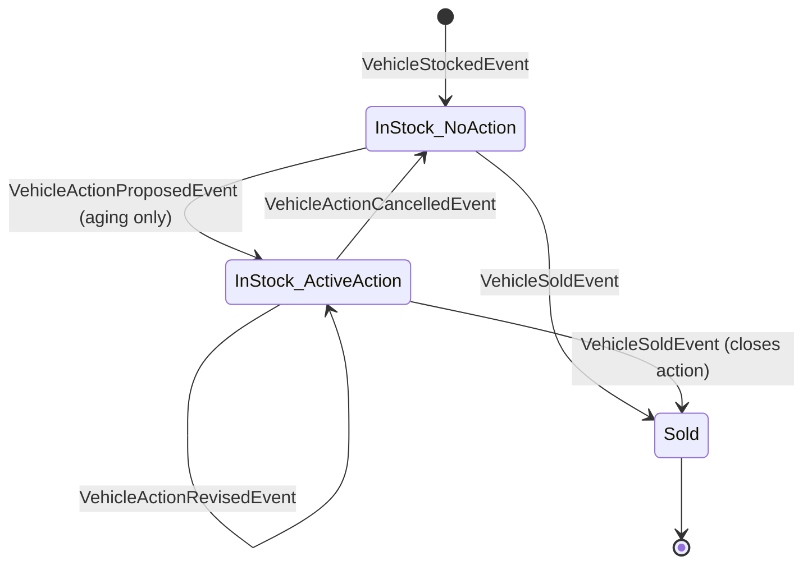

# 03 — Domain Model

**Status (Phase 1, 2026-10-29): implemented** in `internal/domain/aggregates/` (`vehicle_inventory.go`, `commands.go`, `vehicle_inventory_snapshot.go`), `internal/domain/events/`, `internal/domain/{date,inventory,errors}.go`, with unit tests in the same packages. Section 6 lists where the implementation deviates from the earlier design text. Envelope fields `AggregateType`/`SchemaVersion` (§5) are still *(to add)* in Phase 2 (event store).

## 1. Aggregate boundary

**`VehicleInventoryAggregate`**: the stock lifecycle of one physical vehicle at one dealership, from stock-in to sale. There is one aggregate type and one stream per vehicle, keyed by `vehicle_id` (a UUIDv7 string, stored in `es_aggregate.id`). The stored aggregate type is the Go struct name `VehicleInventoryAggregate`, derived by reflection in `aggregateType()` and frozen (D12).

Inside the boundary: VIN, make, model, model year, `stocked_on`, status, `sold_on`, and the active action.
Outside it:
- **Dealership** is reference data (time zone).
- **Active-VIN uniqueness** spans aggregates. It is optional and lives in the store (04 §6).
- **Aging** is derived and time-dependent: never stored, never an event.

A per-dealership aggregate would serialise all writes of a dealership through one stream for no cross-vehicle invariant, so it was rejected.

## 2. How it is built on the existing framework

The framework's pattern is kept as-is:

```
command method (to add)        validate input + current state, compute event payload
   └─ a.ApplyChange(a, &events.X{...})           // pkg/eventsourcing
         └─ a.Transition(event)                  // existing dispatch switch
               └─ applyX(payload) (to fill in)   // structural checks + state mutation
         event appended to pending list only if Transition succeeded (tested)
AggregateStore.Save(ctx, a)                       // existing: one tx, CAS, append, Update()
AggregateStore.Get(ctx, id, &VehicleInventoryAggregate{})  // existing: replay via LoadFromHistory → Transition
```

Consequences:
- **Input and business rules** (VIN format, aging, "no active action") are checked in the **command methods**. They depend on the business date, which is passed in as a parameter. The domain never reads the clock.
- **Structural rules** (first event must be `VehicleStockedEvent`, nothing after a sale, revise/cancel must target the active action) are checked in the **appliers**. They then also guard replay of stored history, because `LoadFromHistory` calls the same `Transition`.
- Version contiguity on replay is already enforced by `AggregateRoot.LoadFromHistory` (tested).

### State *(to add)* — unexported fields on `VehicleInventoryAggregate`

```go
type VehicleInventoryAggregate struct {
    eventsourcing.AggregateRoot
    dealershipID string
    vin, make, model string
    modelYear    int
    stockedOn    domain.Date   // civil date (to add: internal/domain/date.go)
    status       domain.Status // IN_STOCK | SOLD
    soldOn       domain.Date
    activeAction *domain.Action
}
```

The fields are unexported, so the aggregate implements `MarshalJSON`/`UnmarshalJSON` (`vehicle_inventory_snapshot.go`) for snapshots. It is covered by a JSON round-trip test that compares the whole struct and by a test through the real `AggregateStore` (SQLite) that restores from a snapshot after deleting the covered events. Whether snapshots are switched on is decided where the store is built (Phase 2), not here.

### Command methods *(to add)*

```go
func (a *VehicleInventoryAggregate) Stock(cmd StockVehicle, businessDate Date) error
func (a *VehicleInventoryAggregate) ProposeAction(cmd ProposeAction, businessDate Date) error
func (a *VehicleInventoryAggregate) ReviseAction(cmd ReviseAction) error // no-op ⇒ no pending event
func (a *VehicleInventoryAggregate) CancelAction(cmd CancelAction) error
func (a *VehicleInventoryAggregate) Sell(cmd SellVehicle, businessDate Date) error
```

Each one either returns an error and records no pending event, or calls `ApplyChangeWithMetadata` (which exists already) to record one. Metadata (`actor_id`, `correlation_id`, `traceparent`) is attached by the application layer.

## 3. Aging rule *(to add, `internal/domain`)*

```go
const AgingThresholdDays = 90
func AgeDays(stockedOn, businessDate Date) int                  // businessDate − stockedOn
func IsAging(status Status, stockedOn, businessDate Date) bool  // IN_STOCK && AgeDays > 90
func BusinessDate(now time.Time, loc *time.Location) Date        // dealership-local date
```

The stock-in day is day 0. **Exactly 90 days is not aging.** The SQL on the read side (05 §2) must match. A shared boundary fixture (89/90/91 days, time zone, DST, leap day, year boundary) is run against both.

## 4. Commands, invariants, errors

| Command | Preconditions (else error) | Records |
|---|---|---|
| `StockVehicle{dealership_id, vin, make, model, model_year, stocked_on}` (vehicle ID = aggregate ID, set with `SetID`) | not yet stocked (`ErrVehicleAlreadyStocked`); I2, I3 | `VehicleStockedEvent` |
| `ProposeAction{action_id, action_type, note}` | IN_STOCK (`ErrVehicleNotInStock`); no active action (`ErrActionAlreadyActive`); aging at business date (`ErrVehicleNotAging`) | `VehicleActionProposedEvent` |
| `ReviseAction{action_id, action_type, note}` | IN_STOCK; `action_id` is the active one (`ErrActionNotActive`); unchanged values → **no event** | `VehicleActionRevisedEvent` |
| `CancelAction{action_id, reason}` | IN_STOCK; `action_id` is active | `VehicleActionCancelledEvent` |
| `Sell{sold_on}` | IN_STOCK (`ErrVehicleAlreadySold`); `stocked_on ≤ sold_on ≤ business_date` | `VehicleSoldEvent` (closes the active action) |

| ID | Invariant | Enforced in |
|----|-----------|-------------|
| I1 | The stream begins with exactly one `VehicleStockedEvent` (version 1) | applier |
| I2 | VIN is 17 chars `[A-HJ-NPR-Z0-9]` (upper-cased); make/model non-empty, ≤ 64 chars; `model_year` ∈ [1900, year+1]; note ≤ 1000 chars | command |
| I3 | `stocked_on ≤ business_date` | command |
| I4 | One IN_STOCK vehicle per VIN | store, **optional** (D4) |
| I5 | Action commands require IN_STOCK. SOLD is terminal. | command + applier |
| I6 | At most one active action | command + applier |
| I7 | Propose requires aging (D3) | command |
| I8 | Revise/cancel reference the active `action_id` | command + applier |
| I9 | Versions contiguous from 1 | **existing** `LoadFromHistory` + CAS |
| I10 | `OTHER` requires a note | command |

Errors *(to add to `internal/domain/errors.go`, next to the existing `ErrUnknownEventType`)*: `ErrValidation` (with a `ValidationError{Field, Reason}`), `ErrVehicleNotStocked`, `ErrVehicleAlreadyStocked`, `ErrVehicleNotInStock`, `ErrVehicleAlreadySold`, `ErrVehicleNotAging`, `ErrActionAlreadyActive`, `ErrActionNotActive`, `ErrInvalidEventSequence` (implemented).

`ActionType`: `PRICE_REDUCTION`, `PROMOTE`, `TRANSFER`, `AUCTION`, `WHOLESALE`, `HOLD`, `OTHER` (D9).



Aging is a predicate, not a state, so no event fires when a vehicle "turns 91".

## 5. Events

Stored `event_type` values are the Go struct names. They are **frozen** and pinned by `TestVehicleEventsUsePointerPayloads` (existing). Payloads are pointers, and the framework rejects value payloads (tested). Fields are *(to add)* to the existing empty structs. Adding fields to empty structs is backward compatible: nothing is persisted yet.

| `event_type` | Payload (JSON) |
|---|---|
| `VehicleStockedEvent` | `{dealership_id, vin, make, model, model_year, stocked_on: "YYYY-MM-DD"}` (vehicle ID is the envelope's `AggregateID`) |
| `VehicleActionProposedEvent` | `{action_id, action_type, note}` |
| `VehicleActionRevisedEvent` | `{action_id, action_type, note}` (full new values) |
| `VehicleActionCancelledEvent` | `{action_id, reason}` |
| `VehicleSoldEvent` | `{sold_on, closed_action_id}`; `closed_action_id` omitted when no action was active |

Envelope (existing `eventsourcing.Event`): `ID` (= `es_event.id`, the unique event ID), `AggregateID`, `Version`, `EventType`, `Data`, `Metadata` (map: `actor_id`, `correlation_id`, `traceparent`), `CreatedAt` (unix seconds). Additive *(to add)*: `AggregateType`, `SchemaVersion` (0 is read as 1). Schema evolution: when a payload changes shape, bump the version for that type and upcast on read inside the event repo's decode step. Stored rows are never rewritten.

Payloads hold business facts only. No `age_days`, no `is_aging`.

## 6. Phase 1 deviations from the design text above

| Earlier text | Implemented | Reason |
|---|---|---|
| `vehicle_id` in the `VehicleStockedEvent` payload | Not in payload; `VehicleID()` returns `AggregateID()` | One source of truth; no mismatch case to validate |
| `closed_action_id: null` | `string`, `omitempty` | Avoids a pointer in the payload; empty means "none" |
| `ErrVehicleNotFound`, `ErrVehicleAlreadyExists`, `ErrCorruptStream` | `ErrVehicleNotStocked`, `ErrVehicleAlreadyStocked`, `ErrInvalidEventSequence` | Matches the aggregate's view: "not found" is a store concern (`ErrAggregateNotFound`, existing) |
| `ReviseAction` returns `(changed, error)` | returns `error`; callers check `IsUnsaved()` | Same shape as the other commands |
| Snapshots disabled for vehicles | Snapshot JSON implemented and tested; enabling is a store-construction choice | Phase 1 brief required custom JSON with tests if needed |
| `IsAging(status, stockedOn, bd)` free function | `(*VehicleInventoryAggregate).IsAging(bd)` + `domain.AgeInDays` | Brief asked for `IsAging(businessDate)` on the aggregate |
| Command metadata (`actor_id`, …) attached by the application layer | Not yet: commands call `ApplyChange` without metadata | `ApplyChangeWithMetadata` takes a map; how commands receive it is decided in Phase 2 |
