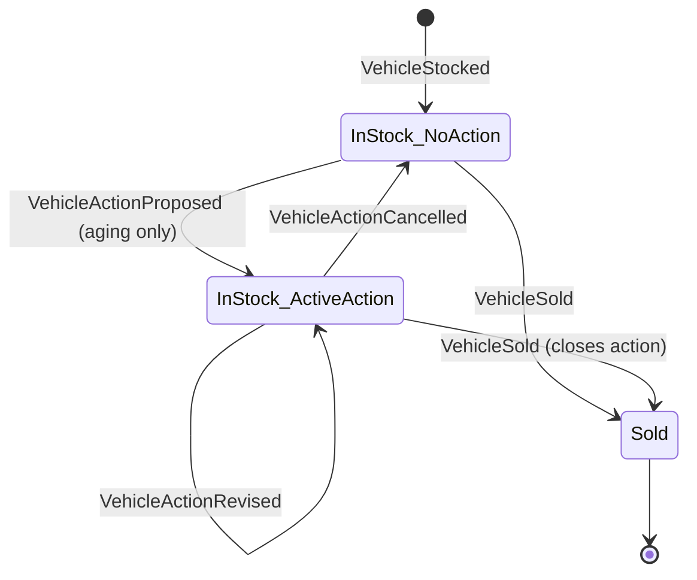

# 03 — Domain Model

## 1. Aggregate boundary

**`VehicleInventory`** (type name `VehicleInventory`): the stock lifecycle of **one physical vehicle at one dealership**, from stock-in to sale. One stream per stock record, ID `vehicle_id` (UUIDv7).

Inside the boundary (must be consistent in one transaction):
- identity and descriptive attributes (VIN, make, model, model year)
- `stocked_on`, status (`IN_STOCK` / `SOLD`), `sold_on`
- the active action (at most one) and its identity

Outside the boundary:
- **Dealership** is reference data (ID, name, time zone). It is read, never modified, by commands.
- **Active-VIN uniqueness** is a set-based rule across aggregates. It is enforced by a reservation table written in the same MySQL transaction as the append (04 §5), not by the aggregate.
- **Aging** is a derived, time-dependent fact. It is never stored and never an event.

Why not a `Dealership` aggregate that holds all its vehicles? It would serialise every write in a dealership through one stream. That causes contention for no invariant that actually spans vehicles, and huge streams.

## 2. State (rebuilt from events only)

```go
type Vehicle struct {
    ID           uuid.UUID
    DealershipID string
    VIN          string
    Make, Model  string
    ModelYear    int
    StockedOn    Date      // civil date, no time zone
    Status       Status    // IN_STOCK | SOLD
    SoldOn       *Date
    ActiveAction *Action   // nil when none
    Version      int       // last applied aggregate version
}
type Action struct {
    ID      uuid.UUID
    Type    ActionType
    Note    string
}
```

Style: **decide/evolve**. Command methods are pure: `func (v *Vehicle) ProposeAction(cmd, BusinessDate) ([]Event, error)`, and `apply(Event)` mutates in-memory state. No generic AggregateRoot framework, no reflection.

## 3. Aging rule

```go
func AgeDays(stockedOn, businessDate Date) int       // businessDate − stockedOn, in days
func IsAging(v Vehicle, businessDate Date) bool     // v.Status == IN_STOCK && AgeDays(...) > 90
const AgingThresholdDays = 90
```

`BusinessDate` = `time.Now().In(dealership.Location)` truncated to a date. It is computed in the application layer through an injected `Clock` and passed into the domain. The domain never reads the clock.

The same rule exists in SQL on the read side (05 §2). A shared table-driven test fixture (89/90/91 days, time-zone boundary, leap day, year boundary) runs against both the Go function and the SQL query so the two cannot drift.

## 4. Commands, events and invariants

### Commands

| Command | Preconditions (else error) | Emits |
|---|---|---|
| `StockVehicle{vehicle_id, dealership_id, vin, make, model, model_year, stocked_on}` | stream does not exist (`ErrVehicleAlreadyExists`); I2, I3; VIN not reserved (`ErrVINAlreadyInStock`, checked in infra) | `VehicleStocked` |
| `ProposeAction{action_id, action_type, note}` | IN_STOCK (`ErrVehicleNotInStock`); no active action (`ErrActionAlreadyActive`); aging at business date (`ErrVehicleNotAging`) | `VehicleActionProposed` |
| `ReviseAction{action_id, action_type, note}` | IN_STOCK; active action with that `action_id` (`ErrActionNotActive`); if nothing changed → **no event, success** (no-op) | `VehicleActionRevised` or nothing |
| `CancelAction{action_id, reason}` | IN_STOCK; active action with that `action_id` | `VehicleActionCancelled` |
| `SellVehicle{sold_on}` | IN_STOCK (`ErrVehicleAlreadySold`); `stocked_on ≤ sold_on ≤ business_date` | `VehicleSold` (closes the active action, if any) |

Every command also carries an `expected_version` (optional, from `If-Match`) and `CommandMeta{command_id, actor_id, correlation_id, idempotency_key, traceparent}`.

### Invariants

| ID | Invariant |
|----|-----------|
| I1 | A stream begins with exactly one `VehicleStocked` at version 1. No other event may be first. |
| I2 | VIN is 17 chars `[A-HJ-NPR-Z0-9]` (upper-cased). Make and model are non-empty, ≤ 64 chars, trimmed. `model_year` ∈ [1900, current year + 1]. The note is ≤ 1000 chars. |
| I3 | `stocked_on ≤ business_date` (no future stock-in in dealership-local time). |
| I4 | At most one `IN_STOCK` vehicle per VIN (infra-enforced, see 04 §5). |
| I5 | Action commands require `IN_STOCK`. `SOLD` is terminal: every command on a sold vehicle is rejected. |
| I6 | At most one active action. |
| I7 | `ProposeAction` requires `IsAging(v, business_date)` (decision D3). |
| I8 | Revise and cancel must reference the active `action_id`. This avoids silently changing an action the caller did not see. |
| I9 | Versions are contiguous: `1..n`. Replay fails loudly on any gap or duplicate. |
| I10 | `action_type = OTHER` requires a non-empty note. |

`ActionType` enum: `PRICE_REDUCTION`, `PROMOTE`, `TRANSFER`, `AUCTION`, `WHOLESALE`, `HOLD`, `OTHER`.

### Lifecycle



Aging is a predicate over (`InStock_*`, `stocked_on`, business date), not a state, so no event fires when a vehicle "turns 91".

## 5. Events (schema_version = 1)

Event type names are stable string constants, independent of Go type names.

| Event | Payload |
|-------|---------|
| `VehicleStocked` | `{vehicle_id, dealership_id, vin, make, model, model_year, stocked_on: "YYYY-MM-DD"}` |
| `VehicleActionProposed` | `{action_id, action_type, note}` |
| `VehicleActionRevised` | `{action_id, action_type, note}` (full new values, not a diff) |
| `VehicleActionCancelled` | `{action_id, reason}` |
| `VehicleSold` | `{sold_on: "YYYY-MM-DD", closed_action_id: uuid \| null}` |

Metadata (all events): `{command_id, actor_id, correlation_id, causation_id, idempotency_key?, traceparent?}`.

Design notes:
- Events record **facts in business terms**. They carry no derived values (no `age_days`, no `is_aging`).
- `closed_action_id` on `VehicleSold` makes the history explicit. The projector does not need to infer which action the sale closed.
- Actor and time sit in metadata and the event row (`occurred_at`), not duplicated in every payload.
- Schema evolution: the decoder dispatches on `(event_type, schema_version)`. Upcasters transform old versions to the current struct. Stored events are never rewritten.
