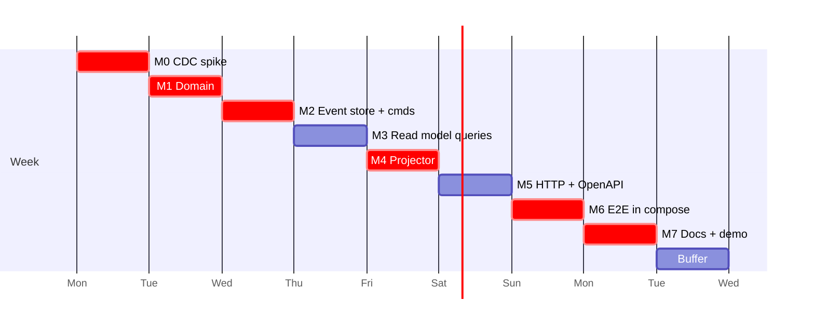

# 07 — Repository Structure, Implementation Plan, Critical Path

## 1. Repository structure

```
cmd/inventory/main.go            # subcommands: api | projector | migrate | rebuild | seed
internal/
  inventory/                     # the bounded context (module)
    domain/                      # PURE: no I/O, no SQL, no HTTP, no clock
      vehicle.go                 #   aggregate state + decide/apply
      commands.go  events.go     #   command structs, event structs + type constants
      codec.go                   #   (event_type, schema_version) ⇄ struct, upcasters
      aging.go     date.go       #   AgeDays, IsAging, civil Date
      errors.go                  #   typed domain errors
    app/                         # use cases: load → decide → append, retries, business date
      commands.go  queries.go
    eventstore/                  # MySQL: Append, Load, ReadAll, ReadStream, idempotency, VIN
    readmodel/                   # Postgres: list/detail/history queries, cursor
    projection/                  # apply logic (PG tx), Kafka consumer, rebuild, gap repair
    httpapi/                     # handlers, DTOs, error→problem mapping, middleware
  platform/                      # cross-cutting, no business logic
    config/  clock/  mysqlx/  pgx/  kafka/  telemetry/ (slog, otel, prometheus)
migrations/
  mysql/0001_event_store.up.sql …
  postgres/0001_read_model.up.sql …
api/openapi.yaml
deploy/
  debezium/inventory-connector.json
  mysql/my.cnf  mysql/init-users.sql
  prometheus/prometheus.yml
docker-compose.yaml   Dockerfile   Makefile
scripts/demo.sh   scripts/seed.json
docs/
```

Dependency rule: `domain` imports nothing from the project. `app` imports `domain` and declares the small interfaces it needs (`EventStore`, `Clock`, `Dealerships`). The infra packages implement them. `httpapi` imports `app`. Interfaces are declared at the consumer only where there is a real second implementation (a test fake or the real DB). No generic repository or generic ES framework.

Integration tests live next to their package behind the `integration` build tag and use testcontainers. `make test` runs unit tests only (fast, no Docker). `make test-integration` and `make e2e` need Docker.

Migration from the current scaffolding: `package/eventsourcing`, `internal/infrastructure/*`, `package/redis` and the GORM/SQLite dependencies are removed in M1. The aggregate-replay test cases worth keeping are ported to `domain` tests.

## 2. Milestones and acceptance tests

Each milestone ends green (`go vet`, `golangci-lint`, its tests) and is committed.

**Every milestone also appends to `docs/ai-log.md` (D11).** The PDF makes "AI engineering & verification" a primary criterion, so evidence is recorded as it happens. Per entry: what was delegated to the AI, what came back, how it was verified (which test or command and its result), and what was **rejected or corrected and why**. Example already available from this planning session: the AI first proposed acceptance criteria without the PDF (which it had missed because the file is untracked). The developer pointed to the file, and the criteria were re-based on it. That added the summary endpoint, the "real-time" target and the README-section requirement.

### M0 — Infrastructure spike (de-risk CDC) · day 1 AM
- Compose: MySQL 8 (binlog config), Kafka KRaft, Debezium Connect, Postgres. Hand-written migration for `event_store`. Connector registration container.
- **Exit**: a manual `INSERT` into `event_store` shows up in `kafka-console-consumer` with **key = aggregate_id** and a decodable value. Capture this message as a golden file for M4.

### M1 — Domain · day 1 PM
- Aggregate, commands, events, codec, aging, errors, Clock. Remove the old scaffolding.
- **Tests (unit, table-driven, given-events/when-command/then-events-or-error)**:
  - every invariant I1–I10 has a rejecting case and an accepting case
  - aging boundary: 89, 90 → not aging; 91 → aging; sold vehicle never aging; time-zone case (UTC instant that is a different date in `Australia/Sydney` vs `America/Los_Angeles`); leap day; year boundary
  - replay: version gap and duplicate version fail; unknown event type fails
  - codec round-trip for every event; upcaster hook test (fake v0 → v1)
  - revise with identical values emits no events

### M2 — Event store + command use cases · day 2
- MySQL migrations, grants and triggers. Append (multi-row, one tx), Load, VIN reservation, idempotency, error mapping (1062/1213/1205), retry loop.
- **Tests (integration, MySQL testcontainer)**:
  - append + load round-trip; multi-event command is all-or-nothing (inject a failure on the 2nd row and assert 0 rows)
  - **concurrency**: 20 goroutines `ProposeAction` on one aging vehicle → exactly 1 success, 19 `ACTION_ALREADY_ACTIVE`, stream versions contiguous 1..2
  - 20 goroutines `ReviseAction` with the same `If-Match` → exactly 1 success, 19 `VERSION_MISMATCH`
  - 10 concurrent `StockVehicle` with the same VIN → exactly 1 success
  - idempotency: same key + same body → identical replay and no new event; same key + different body → 422; concurrent same-key requests → 1 event
  - `UPDATE`/`DELETE` on `event_store` as the app user fails

### M3 — Read model + queries · day 3 AM
- Postgres migrations, list/detail/history/**summary** queries, cursor, business-date resolution.
- **Tests (integration, Postgres)**: summary counts match the list endpoint's counts for the same `as_of` (in stock, `aging=true`, aging with no action); each filter alone and combined; `aging=true` boundary (90 vs 91) using `as_of`; every sort, both directions; keyset pages over 250 rows equal one unpaginated query (no duplicates or omissions, including tie-breaks on equal `stocked_on`); limit default 20, max 100, 101 → 400; cursor tampering → 400; **the same aging fixture as M1 gives the same answers** in SQL; `EXPLAIN` uses the indexes on a 10k-row seed.

### M4 — Projector · day 3 PM – day 4 AM
- Apply logic (PG tx with checkpoint), franz-go consumer with seek-on-assign, gap repair, halt-on-poison, rebuild with an advisory lock.
- **Tests**:
  - unit/integration on `apply` (no Kafka): duplicate is ignored; v1..v4 in order is correct; v1,v3 triggers a repair from a MySQL stub/container; unknown type halts and rolls back; `VehicleSold` closes the action in history
  - decode the M0 golden Debezium message
  - **crash recovery**: apply a record, kill before `COMMIT` → re-delivery applies once; after `COMMIT` → skipped; final state equals the expected state
  - **rebuild equivalence**: generate 500 random valid command sequences, then (a) live-project and (b) truncate + rebuild → both read models are byte-identical (compared with `ORDER BY` dumps)
  - Kafka integration (testcontainers Kafka): restart the consumer mid-stream → no loss, no double-apply

### M5 — HTTP API + OpenAPI · day 4 PM – day 5 AM
- Handlers, middleware (request ID, logging, recovery, tracing, metrics), problem+json, `openapi.yaml`, Swagger UI.
- **Tests**: handler tests with `httptest` against fakes for the error mapping table; the **contract test** validates every integration response against `openapi.yaml`; `X-Actor-Id` missing → 400.

### M6 — End-to-end, observability, seed · day 5 PM
- `docker compose up` runs the whole stack. `inventory seed` loads ~60 vehicles across 2 dealerships with back-dated `stocked_on` (some at exactly 90/91 days). Metrics, traces and the Compose `observability` profile.
- **E2E test (`make e2e`)**: compose up → stock → propose → poll the read API until `version` matches (≤ 10 s) → stop the projector → issue commands → start the projector → read model catches up → `rebuild` → identical results. **B7 check**: 200 sequential commands, then assert p95 command-commit → visible-in-read-API ≤ 2 s and report the measured number in the README.

### M7 — Documentation & demo · day 6
- `docs/system-design.md` (P1) with sections in PDF order: architecture diagram, component roles, data flow, technologies + justification (including the simplest-viable-design comparison, R10), observability, **"How GenAI assisted the design phase"** (drawn from `ai-log.md` entries for this planning stage), and assumptions (01 §3).
- `README.md` (P2): prereqs, `make up`, `make test`, `make test-integration`, `make e2e`, link to cURL examples and Swagger UI, and the **"AI Collaboration Narrative" section** covering strategy for guiding the AI, verification and refinement process, and how final quality was ensured. It is condensed from `ai-log.md` with concrete examples of corrections. No reconstructed or invented activity.
- `docs/demo.md`: video outline with timings per the PDF (intro + scenario ~0:45 · design walkthrough ~2:00 · AI story 1–2 min · live demo ~3:00 · learnings/challenges ~1:00).

### Day 7 — Buffer
Hardening, review pass, `golangci-lint` clean-up, re-run all tests from a clean clone, record the demo video.

## 3. Critical path



The critical chain is **CDC wiring → event store → projector → E2E**. Every other piece can be tested in isolation, but those can only be proven together. That is why M0 comes first: if Debezium misbehaves on day 1 there is still time to fix it. Without the spike it would surface on day 5.

**Contingency** if M0 is still red at the end of day 1: keep the same event store and projector code, and temporarily feed the projector from a MySQL poller that reads `ReadAll(after global_position)` with a safety lag. The `apply` logic and its tests are source-agnostic, so this swaps only the transport. Debezium stays the target, and the trade-off (02 §1) is documented if the fallback ever ships.

## 4. Cut list (in order, if behind schedule)

1. Compose `observability` profile (Jaeger/Prometheus containers). Instrumentation stays.
2. `Idempotency-Key` store. Natural idempotency through domain rules remains (04 §4).
3. `make_model` sort. `age_desc` and `age_asc` remain.
4. Kafka-level testcontainers test. `apply` tests + E2E remain.
5. OpenAPI contract test. The spec is still hand-checked.

Never cut: any B1–B6 criterion, the OCC concurrency test, projector idempotency and gap handling, rebuild, the aging boundary tests, the README and design doc.

## 5. Definition of done (maps to PDF deliverables P1–P4 and brief §9)

| Deliverable | Evidence |
|---|---|
| P1 System Design Document | `docs/system-design.md`: diagram, component roles, data flow, tech + justification, observability, GenAI-in-design section, assumptions |
| P2 Working code + README | `git clone && make up` works on a clean machine. README build/run/test steps verified by following them literally. **AI Collaboration Narrative section in README.** |
| P3 Core business logic tests | `make test` (domain: invariants, aging boundary) + `make test-integration` + `make e2e` green |
| P4 Video | `docs/demo.md` outline + `scripts/demo.sh`: summary tiles → aging list → propose/revise → history → kill projector → catch-up → rebuild |
| Client stub | `api/openapi.yaml` (contract test green) + `docs/curl-examples.md` |
| Migrations, Compose | `migrations/`, `docker-compose.yaml` |
| Observability | `docs/08-observability.md`, metrics visible at `/metrics` |
