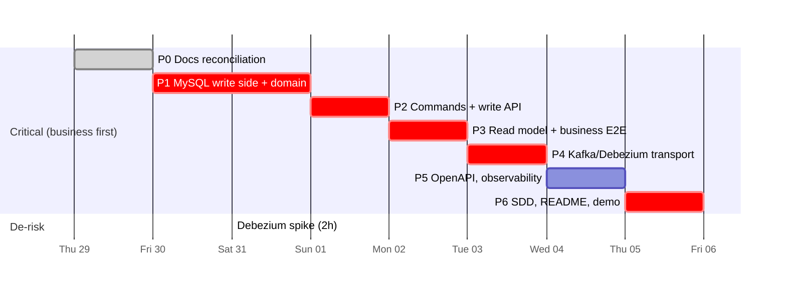

# 07 — Implementation Plan (minimal-change roadmap)

Window: **Thursday 29 October → Wednesday 4 November 2026 (deadline).** Phase 0 (this reconciliation) is done on 29 Oct.

Principles: extend the existing packages instead of adding parallel ones, and validate the existing framework on MySQL before building on it. Every phase ends with `go vet ./...` and `go test ./...` green, and the developer commits it. The AI does not commit. Every phase appends factual entries to [ai-log.md](ai-log.md) (D11).

## 1. Repository structure (existing tree, with additions marked `+`)

```
cmd/main.go                                   existing placeholder → subcommands api|projector|migrate|rebuild
package/eventsourcing/                        existing framework (AggregateRoot, Event, serializer) — reuse
  event.go                                    + AggregateType, SchemaVersion fields
internal/
  domain/
    aggregates/vehicle_inventory.go           existing → + state, command methods, appliers
    events/*.go                               existing empty structs → + payload fields
    errors.go                                 existing → + domain errors
    + date.go, aging.go, action.go            civil Date, aging rule, ActionType/Status
  application/
    command/                                  existing empty → handlers (load → method → Save, retry)
    query/                                    existing empty → list/detail/history/summary
    messaging/                                existing empty → Kafka CDC consumer
  infrastructure/
    eventstore/                               existing AggregateStore — reuse; snapshots off for vehicles
      repos/                                  existing → + versioned Migrate, new columns, ReadAll/ReadStream
      repos/migrations/{mysql,sqlite}/        + 0001 (= today's DDL), 0002 (additive columns)
    projection/                               existing pipeline → tx + version check
      projectors/                             existing stubs → VehicleProjector implemented; Outbox untouched
    viewstore/                                existing interface → + Postgres implementation, migrations
    cache/                                    existing stub — untouched, unwired
  presentation/                               existing empty → HTTP handlers, problem+json
package/redis/                                existing stub — untouched, unwired
api/openapi.yaml                              +
deploy/debezium/connector.json, deploy/mysql/ +
docker-compose.yaml, Dockerfile, Makefile     existing empty files → filled
docs/                                         this folder + system-design.md, demo.md, curl-examples.md, ai-log.md
```

Tests: the existing tests stay as they are. MySQL/Postgres integration tests sit behind the `integration` build tag and read `MYSQL_TEST_DSN` / `PG_TEST_DSN` (Compose services; testcontainers optional, 02 C11).

## 2. Phases

> **Actual sequencing (2026-10-29):**
>
> | Delivered as | Content | State |
> |---|---|---|
> | Phase 1 | Domain only | committed `ac84073` |
> | Phase 2 | MySQL event store: migrations, OCC fix, error classes, grants (`04-event-store.md` §8) | committed `82826e4` |
> | Phase 3 | Application command layer, REST write API, `cmd api|migrate`, dealership reference data, metadata (`06-api-contracts.md` "Phase 3") | uncommitted |
> | Next | PostgreSQL read model + query endpoints, then CDC (Debezium/Kafka) | not started |
>
> Phase numbers below are the original plan. Dates are unchanged.

### Phase 1 — Write side on MySQL + domain · Thu 29 – Fri 30 Oct
Scope (only what the brief's Phase 1 lists):
1. Add `gorm.io/driver/mysql`. Compose service `mysql` only (binlog settings already present for later CDC). Makefile targets `test`, `test-integration`, `mysql-up`.
2. Versioned `repos.Migrate`: `0001` is today's DDL, `0002` adds `es_event.aggregate_type` and `es_event.schema_version` (04 §4). `Event` gains the matching fields. `Append` writes them and `Get` reads them.
3. **Validate the existing store on MySQL:** let the existing `eventstore` tests' `openDB` use MySQL when `MYSQL_TEST_DSN` is set. All 10 existing behaviours then run on both engines.
4. MySQL concurrency tests (H1): N goroutines saving the same existing aggregate from the same base version, and N goroutines creating the same new aggregate. Fix only what the tests show (04 §5).
5. Domain: payload fields, `Date`/aging, errors, `VehicleInventoryAggregate` state, command methods and appliers (03). The vehicle store is built with snapshot interval 0.

Acceptance tests:
- existing 17 tests still green (SQLite)
- existing 10 event-store tests green on MySQL
- concurrency: exactly 1 winner, all losers get `ErrConcurrencyConflict` (not a raw 1213/1205), versions contiguous
- multi-event save is all-or-nothing on MySQL (failure injected on the 2nd insert)
- migration: a DB created by the **current** `Migrate` is upgraded by the new one without error; old rows read back with `schema_version = 1`
- domain unit tests: every invariant I1–I10 has a reject case and an accept case; aging 89/90/91, time zone, DST, leap day; replay of corrupt history fails; command methods leave no pending event on error; identical revise records nothing
- the existing `TestVehicleEventsUsePointerPayloads` still pins the event names

### Phase 2 — Commands + write API · Sat 31 Oct
- `application/command`: load → command method → `Save`, retry ×3 on `ErrConcurrencyConflict`, `If-Match` check, business date from the dealership time zone, metadata (`actor_id`, `correlation_id`).
- `presentation`: POST/PUT command endpoints (06), problem+json, `X-Actor-Id`. `cmd/main.go api|migrate`.
- **Parallel, time-boxed to 2 h:** Debezium spike. Compose `kafka` (KRaft) + `connect`, register the connector, and see an `es_event` row arrive keyed by `aggregate_id`. Save one message as a golden file.
- Tests: handler tests (error → HTTP mapping); MySQL integration test of 20 concurrent `ProposeAction` → 1 × 201, 19 × 409 `ACTION_ALREADY_ACTIVE`.

### Phase 3 — Read model + business E2E without Kafka · Sun 1 Nov
- Postgres schema + `ViewStore` implementation. `Projector` signature change and `VehicleProjector`. `Projection.Apply` with tx + version check (05 §4).
- `repos.ReadAll` + `main rebuild` / catch-up (D14). `application/query` + GET endpoints (list, detail, history, summary).
- **Milestone (end of 1 Nov): PDF business criteria B1–B6 demonstrable through the API**, with the read model fed by catch-up.
- Tests: projection duplicate/gap/unknown-event; summary counts = list counts; filters, `aging=true` at 90 vs 91 via `as_of`; keyset pages over 250 rows equal one unpaginated query; limit 20/100/101; the same aging fixture as Phase 1 run in SQL; rebuild produces the same read model as incremental apply.

### Phase 4 — Live CDC transport · Mon 2 Nov
- `application/messaging` consumer (per-partition sequential, offset commit after the PG commit). Decode the Debezium row into `eventsourcing.Event` via the serializer. Full Compose stack with startup ordering.
- Tests: golden-message decode; E2E: command → visible in the read API (≤ 2 s p95, B7) → stop the projector → more commands → restart → catches up → `rebuild` → identical.
- If the spike failed: ship the catch-up reader as the transport behind the same consumer interface, and document the commit-order caveat (02 §1).

### Phase 5 — Contract, observability, packaging · Tue 3 Nov
- `api/openapi.yaml` + Swagger UI, curl examples, seed command, slog / Prometheus / OTel (08), Dockerfile, Makefile, README build/run/test.

### Phase 6 — Deliverables · Wed 4 Nov (deadline)
- `docs/system-design.md` (P1, including the GenAI-in-design section from `ai-log.md`), the README **AI Collaboration Narrative** section (P2), `docs/demo.md` video outline (P4).
- Final check from a clean clone: `make up`, `make test`, `make test-integration`, `make e2e`. Record the actual outputs.

## 3. Critical path



The chain is **MySQL write side → commands → read model → business E2E**. It delivers every Keyloop-mandatory criterion by 1 Nov, independent of Kafka. Debezium/Kafka (self-imposed) follows on 2 Nov, de-risked by the 31 Oct spike. There is **no buffer day**: the cut list is the buffer.

## 4. Cut list (apply in order when a phase overruns)

1. Re-enabling snapshots for vehicles (stays disabled).
2. Compose observability profile (Jaeger/Prometheus containers). Instrumentation stays.
3. `Idempotency-Key` store. Domain-rule idempotency remains.
4. VIN reservation (D4).
5. Automatic gap repair (D6). Detect + halt remains.
6. Kafka offsets in Postgres (D5). Per-aggregate version remains.
7. `make_model` sort.
8. OpenAPI contract test. The spec remains.
9. Kafka transport itself, as a last resort: ship the catch-up transport (Phase 4 fallback) and document it.

**Never cut:** B1–B7; MySQL OCC/concurrency tests; projector duplicate handling and gap detection; rebuild from MySQL; aging boundary tests; README, SDD, AI narrative.

## 5. Definition of done

| Deliverable | Evidence |
|---|---|
| P1 System Design Document | `docs/system-design.md`: diagram, components, data flow, tech + justification, observability, GenAI-in-design, assumptions |
| P2 Code + README | Clean clone → `make up` works. README steps followed literally. AI Collaboration Narrative section. |
| P3 Core business logic tests | `make test` + `make test-integration` + `make e2e` green, actual output recorded |
| P4 Video | `docs/demo.md` + `scripts/demo.sh` |
| Client stub | `api/openapi.yaml` + `docs/curl-examples.md` |

## 6. Risks and open decisions for Phase 1

| ID | Item | Recommendation |
|----|------|----------------|
| O1 | Append-only **triggers** on MySQL would break the existing corruption-simulation tests (`TestReplayErrors`, the snapshot tests use `UPDATE`/`DELETE es_event`) once they run on MySQL | Enforce append-only by **grants only** in Phase 1. Add triggers later, only if those tests are kept SQLite-only. |
| O2 | H1 deadlock (04 §5) is unverified | Write the concurrency test first. Pick the fix (skip `CreateIfNotExist` for existing aggregates and/or map 1213/1205) only after seeing the result. |
| O3 | MySQL test harness: Compose MySQL + DSN env vs testcontainers (rootless Podman here) | DSN env + Compose |
| O4 | Run the existing event-store tests against MySQL by parametrising `openDB` | Yes, because it validates the framework without duplicating tests |
| O5 | `CreatedAt` precision (unix seconds) | Keep. Revisit only if the lag metric needs sub-second resolution. |
| O6 | Postgres driver for the read side (Phase 3) | Decide before Phase 3: `gorm.io/driver/postgres` (consistent with the write side) or `pgx` |
| O7 | D3 (propose only on aging vehicles) | Confirm |
| O8 | Versioned migration refactor vs simply editing `schema.sql` (nothing is deployed yet) | Versioned. It is small, and it is the only honest answer to "migration compatibility". |
| R | `AggregateRoot.ApplyChange` uses `time.Now().Unix()` | Tests must not assert exact timestamps. A clock injection can be added later, non-breaking. |
