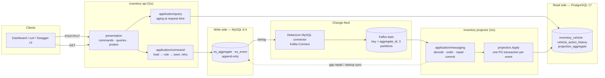
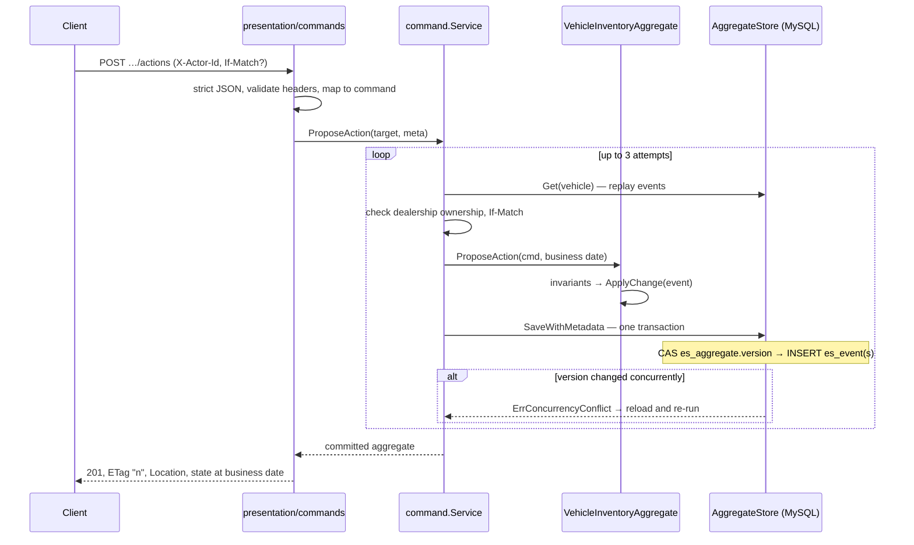

# System Design — Intelligent Inventory Dashboard (Keyloop Scenario B)

Backend for a dealership inventory dashboard. It lists each dealership's vehicles with their age, identifies aging stock (more than 90 days) automatically and prominently, and lets a manager log, revise and cancel a proposed action for each aging vehicle, with a full history.

The detailed design notes this document summarises are in `docs/01`–`08`. The API contract is [`api/openapi.yaml`](../api/openapi.yaml).

## 1. Requirements and assumptions

| ID | Requirement (from the challenge PDF) | Where it is met |
|---|---|---|
| B1 | Inventory list per dealership with make, model and age in days | `GET /v1/dealerships/{id}/vehicles`, `age_days` on every row |
| B2 | Filter by make, model and age | `make`, `model` (exact, case-insensitive), `min_age_days`, `max_age_days` (inclusive) |
| B3 | Aging (> 90 days in stock) identified **automatically** | `is_aging` is computed at request time from `stocked_on` and the dealership's business date: no job, no stored flag |
| B4 | Aging stock shown **prominently** | `aging=true` filter, oldest-first default sort, `GET …/inventory/summary` (in stock, aging, aging without action) |
| B5 | A manager logs and persists a status / proposed action per aging vehicle | `POST …/actions`, `PUT …/actions/{id}`, `POST …/cancel` as events in MySQL |
| B6 | Current action and its history | `current_action` on reads; `GET …/actions` (audit trail with actor and correlation ID) |
| B7 | "Real-time" overview | Read model updated by CDC, median ≈ 0.5 s on one host (§12); aging needs no refresh |

**Assumptions** (`docs/01` §3):

- **Business date and age.** The business date is "today" in the dealership's IANA time zone. `age_days = business_date − stocked_on` in calendar days, so the stock-in day is day 0. Aging means `IN_STOCK` and `age_days > 90`, so exactly 90 days is **not** aging.
- **Sold vehicles.** A sold vehicle is never aging; its age is frozen at `sold_on`.
- **Actions.** "Status / proposed action" is one concept, and a vehicle has at most one active action. It can only be proposed for an aging vehicle. A sale closes it.
- **Identity.** There is no authentication. `X-Actor-Id` is a demo-only identity recorded for audit (§13).
- **Tenancy.** Every request is scoped by the dealership in the URL. A vehicle of another dealership returns 404.
- **Vehicle source.** Vehicles enter only through the API (no DMS integration). `stocked_on` is a business fact and may be in the past.

**Self-imposed (not required by the PDF), justified below:** Event Sourcing and CQRS, a MySQL event store, Debezium/Kafka change data capture, and a PostgreSQL read model.

## 2. Architecture



| Component | Role | Technology and why |
|---|---|---|
| API (`cmd api`) | REST commands and queries, problem+json errors, probes, metrics, OpenAPI | Go stdlib `net/http` routing. No framework is needed for 9 endpoints. |
| Command service | Loads the aggregate, applies the business rule at the dealership business date, saves with optimistic concurrency, retries on conflict | The `package/eventsourcing` framework already in the repository is extended rather than replaced. |
| Event store | `es_aggregate` (version CAS) and `es_event` (append-only, `UNIQUE(aggregate_id, version)`) | MySQL 8.4: transactional, row-based binlog for CDC. This was the existing GORM store. |
| Debezium + Kafka | Streams committed `es_event` rows in commit order, keyed by vehicle | The binlog is the outbox, so events and their publication commit atomically without a dual write. Kafka gives per-key ordering, replay and consumer groups. |
| Projector (`cmd projector`) | Applies the change feed to the read model; bootstraps and recovers from MySQL | A separate process that scales independently of the API. franz-go is a pure-Go Kafka client with manual offset control. |
| Read model | Denormalised current state, action history, applied version per vehicle | PostgreSQL 17: keyset pagination, partial-index-friendly queries, read-only role for the API. |

**Packages** follow `presentation → application → domain`. Infrastructure implements ports declared by the application:

- `internal/domain`: aggregate, events, `Date`, aging rule. No I/O.
- `internal/application`: `command`, `query`, `messaging`.
- `internal/infrastructure`: `eventstore`, `viewstore`, `projection`, `kafka`, `referencedata`.
- `internal/presentation`: `commands`, `queries`, `probes`, `apidocs`, `httpkit`.

A test pins the presentation sub-package dependency direction.

## 3. Command-side flow



- The business date is resolved once per command from the dealership's time zone (MySQL `dealership` reference table). The domain never calls `time.Now()`.
- Metadata stored with every event: `actor_id` (`X-Actor-Id`), `correlation_id` (`X-Request-Id`) and, when valid, `traceparent`.
- The response is the **write-side** state. The acting manager therefore never sees read-model lag on their own command.

## 4. Event Store design

```
es_aggregate(id PK, version, aggregate_type)                    -- one row per vehicle: the concurrency token
es_event(id AUTO_INCREMENT PK, aggregate_id, aggregate_type, event_type, version,
         schema_version, data JSON-as-TEXT, metadata, created_at,
         UNIQUE(aggregate_id, version))                        -- append-only history
es_aggregate_snapshot(aggregate_id, version, data)              -- supported, disabled for vehicles (interval 0)
```

- **Atomic save:** the CAS `UPDATE es_aggregate SET version = new WHERE id = ? AND version = expected`, all `INSERT es_event` rows and an optional snapshot run in **one** transaction.
- **Append-only:** the application user has `INSERT, SELECT` on `es_event` only, with no `UPDATE`/`DELETE` (`deploy/mysql/grants.sql`, tested).
- **Event names are Go type names and are frozen:** `VehicleStockedEvent`, `VehicleActionProposedEvent`, `VehicleActionRevisedEvent`, `VehicleActionCancelledEvent`, `VehicleSoldEvent`.
- **Schema evolution:** payloads carry `schema_version`, and readers reject versions they do not know rather than guess. Changes must be additive; a breaking change needs a new schema version and an upcaster.
- **Migrations:** versioned and additive (v1 original DDL, v2 `aggregate_type` and `schema_version`, v3 dealership reference data), serialised with `GET_LOCK`. A database newer than the binary is refused.
- **Snapshots:** the framework supports them, and the round trip is tested through the real store. Vehicles keep them off because their streams are short (stock, a few actions, sale).

## 5. Aggregate modelling

One aggregate per vehicle (`VehicleInventoryAggregate`). Every command validates and records an event; every `apply` method re-checks ordering, so a replay of a corrupt history fails with `ErrInvalidEventSequence`.

| Command | Event | Invariants |
|---|---|---|
| Stock | `VehicleStocked` | Once per aggregate. VIN is 17 characters without I/O/Q. Make and model are 1–64 characters. `model_year` is between 1900 and the business year + 1. `stocked_on` is not after the business date. |
| ProposeAction | `VehicleActionProposed` | `IN_STOCK`; **aging at the business date**; no active action; `note` required for `OTHER` |
| ReviseAction | `VehicleActionRevised` | The `action_id` must be the active action. An identical revision records **no** event. |
| CancelAction | `VehicleActionCancelled` | The `action_id` must be the active action. |
| Sell | `VehicleSold` (closes the active action) | `IN_STOCK`; `stocked_on ≤ sold_on ≤ business date`. Terminal. |

Versions run contiguously from 1. Aging is a **pure function** of `stocked_on`, status and a date. It is never stored, so it cannot go stale.

## 6. CQRS read model

```
dealership(dealership_id, name, timezone)                                     -- reference copy
inventory_vehicle(vehicle_id PK, dealership_id, vin, make, model, model_year, stocked_on,
                  status, sold_on, action_* (current action), version, last_event_id, updated_at)
vehicle_action_history(vehicle_id, version PK, event_id, action_id, change, action_type,
                       note, reason, actor_id, correlation_id, occurred_at)
projection_aggregate(aggregate_id PK, version, last_event_id)                 -- applied version per vehicle
projection_run(kind, started_at, finished_at, events_read, events_applied)    -- sync/rebuild audit
```

- **Writes:** only the projection writes, as the schema owner. The API reads as a role with `SELECT` on four tables.
- **Queries:**
  - age and aging are computed in Go with the domain rule at the business date;
  - the filters are translated to sargable `stocked_on` bounds;
  - the summary uses the same cutoff as the list (tested equal).
- **Pagination** is keyset on `(stocked_on, vehicle_id)`. The cursor is opaque and pins `as_of` and a fingerprint of the filters, so a changed filter or a midnight crossing returns `400 INVALID_CURSOR` instead of skipping or repeating rows.

## 7. Debezium and Kafka pipeline

- **Capture:** the connector (`deploy/debezium/es-event-connector.json`) captures `inventory.es_event` only.
  - Key: `aggregate_id`. Values: JSON without schemas. Only those settings and the full envelope (no unwrap SMT).
  - The snapshot is ordered by `(aggregate_id, version)`, with `snapshot.mode=when_needed`.
  - `skipped.operations=none`, so updates, deletes and truncates of the append-only table are **emitted and detected**, not dropped.
- **Topic:** `inventory.inventory.es_event`, 3 partitions, 7-day retention. One vehicle's events share a partition and keep commit order. Connect producers run with `acks=all` and `max.in.flight=1`.
- **Consumer** (`internal/application/messaging`, transport `internal/infrastructure/kafka`):
  1. Decode the key and the envelope; accept only `op` `c`/`r` on `es_event`, with the key equal to the row.
  2. Deserialise with the same serializer registrations as the event store.
  3. Apply through `Projection.Apply`.
  4. Commit the Kafka offset only after the PostgreSQL commit.
  5. Process partitions in parallel, records within a partition strictly in order.
  6. Block rebalances between poll and commit.
- **Poison and errors:** a failing record halts its partition (rewind and backoff, never skip); poison is logged at ERROR and makes the process not ready. Details: `docs/05` §7.

## 8. Data consistency model

| Side | Guarantee |
|---|---|
| Write (MySQL) | Strongly consistent per vehicle: serialised by the version CAS. Command responses show committed state. |
| Read (PostgreSQL) | **Eventually consistent**, monotonic per vehicle: the version check means a row never moves backwards. No cross-vehicle snapshot consistency. |
| Read-your-writes | By version comparison: the command response carries `version`; a GET may briefly show an older one. |
| Aging | Never stale: computed per request from immutable `stocked_on`. |

**At-least-once end to end; idempotent by version.** `Projection.Apply` locks the vehicle with `pg_advisory_xact_lock`, which also covers a vehicle with no row yet, and reads its applied version:

- `version ≤ applied`: a duplicate, skipped;
- `version = applied + 1`: applied, and state, history and the applied version commit in one transaction;
- otherwise: a gap (§10).

Exactly-once across MySQL → Kafka → PostgreSQL is **not** claimed.

## 9. Concurrency and optimistic locking

- **Writers of one vehicle race on the `es_aggregate` CAS.** The loser gets `ErrConcurrencyConflict`; the service reloads and re-runs the command (3 attempts), so the rule is re-evaluated on fresh state. It is never a blind re-insert.
- **The unique `(aggregate_id, version)` is the second guard.**
- **A MySQL deadlock was found and fixed.** `INSERT IGNORE` + CAS under concurrent creation produced error 1213, reproduced by tests and fixed with `INSERT … ON DUPLICATE KEY UPDATE`. Lock waits and deadlocks map to a retryable error.
- **Tested on MySQL 8.4:** N goroutines saving the same vehicle → exactly one winner, contiguous versions. 16 concurrent `ProposeAction` requests over HTTP (5 rounds) → exactly one 201 and 15 × `409 ACTION_ALREADY_ACTIVE` per round.
- **`If-Match`** gives clients an explicit precondition. A stale ETag returns `412 VERSION_MISMATCH` even when it is discovered during a retry, and takes precedence over a conflict.
- **Projector concurrency:**
  - a shared projection lock for each event transaction, and an exclusive one for sync and rebuild runs;
  - per-vehicle advisory locks;
  - partitions processed in parallel, never two goroutines on one partition (fetches are merged per partition).

## 10. Idempotency, retries and recovery

| Boundary | Behaviour |
|---|---|
| HTTP command | **No `Idempotency-Key`** (cut for time). Most retries are safe by business rule: re-stocking the same `vehicle_id` gives 409, proposing while active gives 409, an identical revision records nothing. `If-Match` makes a retry conditional. A `503` means the outcome is unknown: read the vehicle before retrying. |
| Command service | Bounded reload-and-retry on optimistic conflicts and retryable MySQL errors only. |
| Debezium | At-least-once; resumes from its binlog offset; re-snapshots `when_needed`. Duplicates are skipped by version. |
| Projector | Offset committed after the PG commit. A crash before the PG commit re-applies; a crash after it re-reads and skips. A failing record is retried in place with backoff; other partitions continue. |
| Gap in the feed | Versions `1…v−1` are read from MySQL (`ReadStream`) and applied first. If MySQL lacks them too, the partition halts (poison). |
| Startup | `Runner.Sync` applies everything committed before the projector joins its group, from one consistent MySQL snapshot. |
| Kafka retention / log truncation | franz-go reports data loss; the consumer re-syncs from MySQL before continuing. |
| Rebuild | `rebuild-projections` truncates and replays the full MySQL history in one transaction under the exclusive lock, safe while the projector runs. |

## 11. Aging calculations and indexing

- **Rule:** `age_days = business_date − stocked_on` in calendar days, from `domain.Date` (no instants, so DST cannot shift it). Aging means `IN_STOCK ∧ age_days > 90`. A sold vehicle's age stops at `sold_on`.
- **Business date:** today in the dealership's time zone, or the `as_of` override for what-if views and boundary checks.
- **Filters become sargable predicates on `stocked_on`:**
  - `aging=true` → `status = 'IN_STOCK' AND stocked_on <= business_date − 91`;
  - `min_age_days` → `stocked_on <= bd − min`;
  - `max_age_days` → `stocked_on >= bd − max`.
- **Indexes:** `(dealership_id, status, stocked_on, vehicle_id)` serves the default list, aging, both sorts and keyset paging; `(dealership_id, status, lower(make), lower(model), stocked_on, vehicle_id)` serves make/model filters. Index use was verified with `EXPLAIN` on 5,000 rows.
- **Boundary tests:** 89/90/91 days, leap years, the year boundary, time zones (London / Sydney) and DST, in the domain, the SQL and the end-to-end flow.

## 12. Failure scenarios

| Scenario | Effect | Handling |
|---|---|---|
| Two managers act on the same vehicle | One wins | Loser retried on fresh state → 409 (rule) or success; `If-Match` → 412 |
| MySQL unavailable | Commands fail | `503 UNAVAILABLE` + `Retry-After`; API `/readyz` 503 |
| PostgreSQL unavailable | Queries fail; projector retries the record | Queries return `500 INTERNAL` (only a request timeout maps to 503); projector partition halted (not ready) until PG returns; nothing skipped |
| Kafka down | No propagation | Projector `/readyz` 503 (verified by stopping Kafka: 503 at once, 200 again 11 s after restart); commands still succeed |
| Connector restarted, paused or re-created | Possible replays | Resumes from stored offset; replays skipped (pipeline test) |
| Projector crash before/after PG commit | Re-delivery | Rolled back and re-applied / skipped by version (tests on real Kafka) |
| Unknown event type, newer schema, malformed record | Cannot be applied | Partition halts (poison), ERROR log, not ready. Runbook: deploy a build that knows it. Never skipped. |
| `es_event` truncated or rows updated | History rewritten outside the app | Detected (`op` `t`/`u`/`d`) → halt; rebuild after repair (pipeline test) |
| Read model lost or corrupted | Stale or empty reads | `make rebuild-projections` from MySQL |

Measured on this machine (WSL2, rootless Podman, single host): command → row visible through the API in 376–493 ms over 20 commands (median 478 ms). This is not a load test.

## 13. Security considerations

- **No authentication.** `X-Actor-Id` is an unauthenticated, demo-only identity: required on commands, validated against a safe charset, stored for audit, **never** used for authorization. Production would use an authenticated principal (OIDC/JWT) and per-dealership authorisation.
- **Least privilege:**
  - the API writes as a MySQL user without `UPDATE`/`DELETE` on `es_event` and reads PostgreSQL as a read-only role;
  - the Debezium account has only replication privileges plus `SELECT` on `es_event`.
- **Least-privilege gaps (known issues):**
  - the projector reads MySQL as the application user, which can `INSERT` events;
  - the projector and the projection commands write PostgreSQL as `POSTGRES_USER`, which the postgres image creates as a **superuser**. A process that applies records from an unauthenticated broker should use a non-superuser role with DML on the projection tables only;
  - MySQL `root` is reachable from the Compose network (`root@'%'`).
- **Grant scripts:** the init jobs refuse empty passwords and anything other than letters and digits, because passwords are substituted into SQL. Each run re-applies the password (`ALTER USER` / `ALTER ROLE`), so rotating it in `.env` takes effect. Root's password reaches the mysql client through `MYSQL_PWD`, not the command line.
- **Input handling:**
  - strict JSON: `application/json` only, 64 KiB limit, unknown fields and trailing data rejected;
  - unknown or repeated query parameters are rejected;
  - all SQL is parameterised, and sort/filter choices map to fixed SQL;
  - cursors are not signed, but they only select rows the caller could request directly.
- **Error exposure:** 500s carry no internal detail, only a `request_id` that matches the log line.
- **Secrets:** only in `.env` (git-ignored). The image contains no credentials. Connect reads the Debezium password from its environment (`${env:…}`), so it is not stored in the connector config.
- **Containers:** distroless static image as `nonroot`, base images pinned by digest; every port published on 127.0.0.1 only. The infrastructure images in Compose are pinned by tag only (`mysql:8.4` and `postgres:17` float), and there are no resource limits.
- **Swagger UI** (`/docs`) loads its assets from jsDelivr, pinned to one version, with Subresource Integrity and a strict Content-Security-Policy (no `unsafe-eval`; the one inline script is allowed by hash). The page was checked to render in headless Chromium without violations.
- **Metrics labels are bounded** (route patterns, and methods outside the standard set fold into `OTHER`), so clients cannot grow the series count.
- **Unauthenticated infrastructure:** Kafka, Connect and the projector's `/status` and `/metrics` have no authentication, which is acceptable only on a private network.
- **Dependencies (`govulncheck`, Phase 6):** 17 reachable findings with the local Go 1.26.5 toolchain.
  - **Standard library:** 15 findings. Fixed in 1.26.6 to 1.26.10.
  - **`golang.org/x/text` v0.40.0:** GO-2026-6629, fixed in v0.41.0. The Prometheus client raised `x/text` from v0.21.0, which removed an older finding.
  - **`pgx` v5.6.0:** GO-2026-5004, fixed in v5.9.2. Low exploitability here: no simple-protocol mode and no dollar-quoted literals in the Go SQL; this is an inference, not proven.
  - **Image toolchain:** the image builds with Go 1.26.9, so it carries every standard-library fix except GO-2026-6809 (1.26.10). The tests run on 1.26.5, so the shipped binary is built by a newer patch release than the tested one.
  - **Deliberately not upgraded** (§16): the Go toolchain, pgx and x/text.

## 14. Observability

- **Logs:** structured JSON (`log/slog`).
  - Every HTTP request logs one line with request ID, route pattern, status, duration and sanitised actor.
  - Errors are logged with their problem code.
  - The projector logs bootstrap, gap repairs, poison records (ERROR) and rebalances.
- **Correlation:** `X-Request-Id` is accepted or generated, echoed in the response, written to the event metadata as `correlation_id`, and returned in action history and problem bodies. A request can be followed from the API log to MySQL to the read model. A valid `traceparent` is stored too.
- **Metrics (Prometheus, `GET /metrics` on both processes):**
  - API: `inventory_http_requests_total{method,route,status}`, `inventory_http_request_duration_seconds{method,route}`, and `inventory_http_problems_total{route,code}` (command success and failure by business outcome, e.g. `VEHICLE_NOT_AGING`). Plus Go and process metrics.
  - Projector: `inventory_projection_events_applied_total`, `…_duplicates_skipped_total`, `…_gap_events_repaired_total`, `…_record_failures_total`, `…_ready`, `…_phase{phase}`, `…_partition_halted{topic,partition}`, `…_partition_last_offset`, and `…_last_change_lag_seconds` (apply time minus the MySQL commit time Debezium reports; clocks of different hosts).
- **Health:**
  - API `/readyz` checks MySQL and PostgreSQL.
  - Projector `/readyz` is 503 while bootstrapping, while the broker is unreachable or while a partition is halted. `/status` gives the detail.
- **Not included:** OpenTelemetry tracing and dashboards and alerts. The trace context is accepted and stored, but no spans are exported. A Prometheus server is not part of the Compose file.

## 15. Scalability trade-offs

- **API:** stateless and horizontally scalable. Commands touch one vehicle's stream (a short, indexed range read), and queries are single-dealership index scans with keyset pagination (no `OFFSET`, no count).
- **Write contention** is per vehicle only; different vehicles never conflict.
- **Projector:** scales by consumer-group members up to the partition count (3). A halted partition holds back every vehicle on it (strict order). Raising the partition count changes key → partition and loses in-order delivery for existing keys; correctness then rests on gap repair and duplicate skipping.
- **Startup sync and rebuild** are O(total events) and hold the exclusive projection lock. That is fine for the assumed scale (thousands of vehicles per dealership); at larger scale use a checkpointed catch-up and a shadow-table rebuild.
- **Single-node infrastructure** in Compose: Kafka with replication factor 1 and one Connect worker. Production needs replication and managed brokers.
- **Event Sourcing cost:** two databases and a CDC pipeline for a CRUD-sized domain. Justified by the audit trail (B6), safe concurrent actions, and a read model that can be rebuilt or reshaped from history. For this scope alone a single PostgreSQL with an audit table would suffice; this is a deliberate, self-imposed demonstration (`docs/02`).

## 16. Limitations and future improvements

- **Security:** no authentication or authorisation; `X-Actor-Id` is trusted.
- **Idempotency:** no `Idempotency-Key`; retries rely on business-rule idempotency and `If-Match`.
- **VIN uniqueness among in-stock vehicles** (planned D4) is not enforced. Two vehicles can be stocked with the same VIN.
- **Reference data is duplicated:** dealership data is seeded in MySQL and PostgreSQL. Adding a dealership requires both.
- **No correction events:** for example a wrong `stocked_on` cannot be corrected (planned `VehicleStockInDateCorrected`).
- **Read-model version:** the detail `ETag` can lag the write side briefly. A `412` from it is resolved by re-reading.
- **Dependency upgrades not done:** pgx and the Go toolchain (`govulncheck` findings).
- **Least privilege for the projector:** it should use a read-only MySQL user and a non-superuser PostgreSQL role (it uses the image-created superuser today).
- **Query outages:** queries map a read-model outage to `500 INTERNAL`, not `503`; only a timeout gives `503`.
- **Connector configuration:** `deploy/debezium/es-event-connector.json` hard-codes the `inventory` database and the `debezium` user. Changing `MYSQL_DATABASE` or `DEBEZIUM_MYSQL_USER` in `.env` therefore also requires editing it.
- **Compose images:** the infrastructure images are pinned by tag, not by digest, and have no resource limits.
- **Observability gaps:** no tracing export, no alert rules, no Grafana dashboard.
- **Tested scope:** a single host; no load or soak test; Kafka retention expiry not reproduced on the real stack.
- **Compose ordering on Podman:** `docker compose up` relies on Compose v2's `depends_on: service_completed_successfully`. `make stack-up` runs the init steps explicitly and works on both Docker Compose and podman-compose. Only podman-compose was available for verification.

## 17. How GenAI contributed

The full factual record is [`docs/ai-log.md`](ai-log.md). This section summarises it; nothing here goes beyond that log.

- **Tool and set-up:** Claude Code (Claude Opus 5.5) was used throughout. The developer configured the work with:
  - a project `CLAUDE.md`, rules for architecture, Event Sourcing, testing and source organisation;
  - plan, test, review and security skills;
  - read-only reviewer agents;
  - safety hooks.

  Phases were planned, approved by the developer, implemented, tested, reviewed and logged one at a time. The AI never committed.
- **Design:** the AI analysed the PDF, wrote the requirements, assumptions and design notes (`docs/01`–`08`), and proposed the CQRS/CDC architecture.
  - Its first proposal was to **rewrite the existing framework**. That claim was made without running the existing tests, and the developer rejected it.
  - The design then pivoted to extending the existing GORM event store, `AggregateRoot`, serializer and projection packages. That constraint shaped §4 and §6.
- **Hypotheses before fixes.** For example, a suspected MySQL deadlock (H1) was written down, reproduced by new concurrency tests (error 1213), then fixed with a one-statement change.
- **Verification habits:**
  - every phase ran gofmt, vet, unit, race and real MySQL/PostgreSQL (later Kafka/Debezium) tests, with outputs recorded;
  - mutation checks confirmed that important tests can fail; some first-version tests could not, and were strengthened;
  - independent read-only review agents found real issues the implementing session missed.
- **What review found:**
  - a 409-instead-of-412 bug;
  - a projector that could skip a halted record after Kafka retention;
  - a truncate of the event table that Debezium silently dropped by default;
  - a readiness blind spot when the broker is unreachable.
- **Mistakes the AI made, and how they were caught (all logged):**
  - it missed the PDF at first;
  - its first projection design took one advisory lock per vehicle and would have exhausted the lock table;
  - a `pkill` killed its own shell;
  - test cases silently tested the valid input;
  - a `git reset` on the index violated a project rule (restored and disclosed);
  - a Makefile variable broke in sub-makes, found by the clean-start run in Phase 6.

  Each was corrected and recorded rather than hidden.
- **Developer interventions:**
  - rejected the rewrite;
  - fixed the TLS proxy issue that blocked image pulls;
  - approved each phase plan;
  - reviewed and committed each phase.
