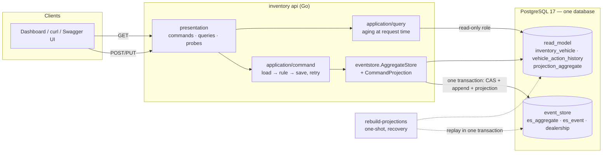
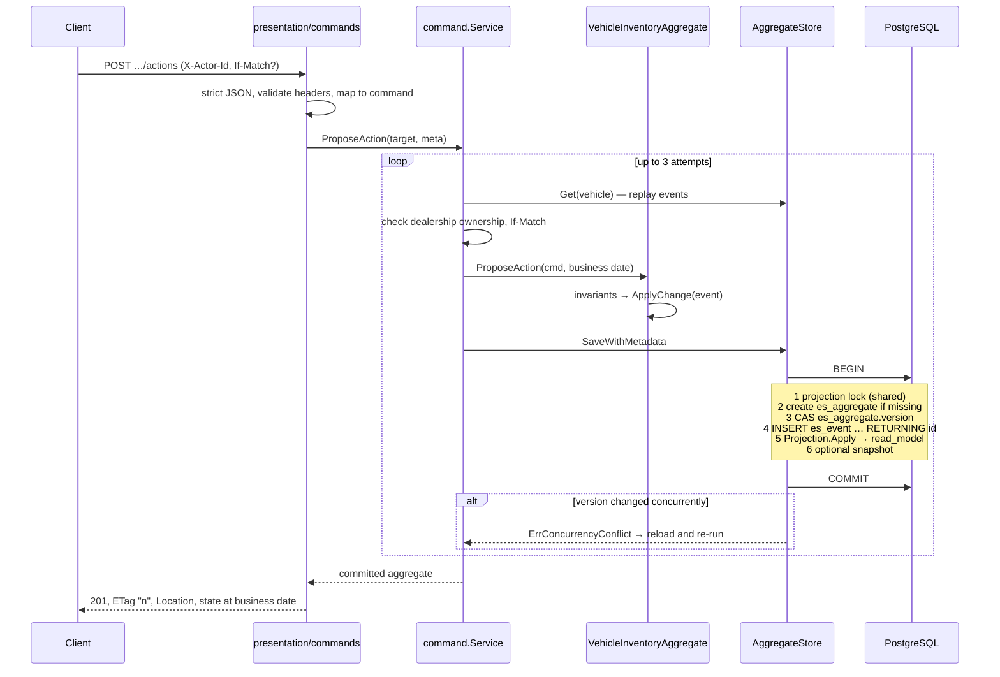

# System Design — Intelligent Inventory Dashboard (Keyloop Scenario B)

Backend for a dealership inventory dashboard. It lists each dealership's vehicles with their age, identifies aging stock (more than 90 days) automatically and prominently, and lets a manager log, revise and cancel a proposed action for each aging vehicle, with a full history.

The detailed design notes this document summarises are in `docs/01`–`08`. The API contract is [`api/openapi.yaml`](../api/openapi.yaml).

**History.** Until Phase 7 the system ran a MySQL event store, Debezium, Kafka and a separate projector process that fed a PostgreSQL read model. The developer decided to replace that with one PostgreSQL database (§15). The earlier design and the reasons it was chosen remain in `docs/02`, `04`, `05` and `07`, marked as superseded.

## 1. Requirements and assumptions

| ID | Requirement (from the challenge PDF) | Where it is met |
|---|---|---|
| B1 | Inventory list per dealership with make, model and age in days | `GET /v1/dealerships/{id}/vehicles`, `age_days` on every row |
| B2 | Filter by make, model and age | `make`, `model` (exact, case-insensitive), `min_age_days`, `max_age_days` (inclusive) |
| B3 | Aging (> 90 days in stock) identified **automatically** | `is_aging` is computed at request time from `stocked_on` and the dealership's business date: no job, no stored flag |
| B4 | Aging stock shown **prominently** | `aging=true` filter, oldest-first default sort, `GET …/inventory/summary` (in stock, aging, aging without action) |
| B5 | A manager logs and persists a status / proposed action per aging vehicle | `POST …/actions`, `PUT …/actions/{id}`, `POST …/cancel` as events in `event_store.es_event` |
| B6 | Current action and its history | `current_action` on reads; `GET …/actions` (audit trail with actor and correlation ID) |
| B7 | "Real-time" overview | The read model is updated in the command's own transaction: a query after a command already sees it. Aging needs no refresh. |

**Assumptions** (`docs/01` §3):

- **Business date and age.** The business date is "today" in the dealership's IANA time zone. `age_days = business_date − stocked_on` in calendar days, so the stock-in day is day 0. Aging means `IN_STOCK` and `age_days > 90`, so exactly 90 days is **not** aging.
- **Sold vehicles.** A sold vehicle is never aging; its age is frozen at `sold_on`.
- **Actions.** "Status / proposed action" is one concept, and a vehicle has at most one active action. It can only be proposed for an aging vehicle. A sale closes it.
- **Identity.** There is no authentication. `X-Actor-Id` is a demo-only identity recorded for audit (§13).
- **Tenancy.** Every request is scoped by the dealership in the URL. A vehicle of another dealership returns 404.
- **Vehicle source.** Vehicles enter only through the API (no DMS integration). `stocked_on` is a business fact and may be in the past.

**Self-imposed (not required by the PDF), justified below:** Event Sourcing and CQRS, with the event store and the read model as two schemas of one PostgreSQL database.

## 2. Architecture



| Component | Role | Technology and why |
|---|---|---|
| API (`cmd api`) | REST commands and queries, problem+json errors, probes, metrics, OpenAPI | Go stdlib `net/http` routing. No framework is needed for 9 endpoints. Two connection pools: commands as the writer role, queries as the read-only role. |
| Command service | Loads the aggregate, applies the business rule at the dealership business date, saves with optimistic concurrency, retries on conflict | The `package/eventsourcing` framework already in the repository is extended rather than replaced. |
| Event store (`event_store` schema) | `es_aggregate` (version CAS) and `es_event` (append-only, `UNIQUE(aggregate_id, version)`), `dealership` reference data | PostgreSQL through GORM with raw SQL (the existing store). |
| Command projection | Applies the command's events to the read model inside the save transaction | The same `Projection.Apply` and `VehicleProjector` a rebuild uses. |
| Read model (`read_model` schema) | Denormalised current state, action history, applied version per vehicle | Keyset pagination, index-friendly queries, read-only role for queries. |
| Rebuild (`cmd rebuild-projections`) | Replaces the read model with a replay of the whole event store | One transaction under an exclusive advisory lock, as a separate rebuild role. |

**Packages** follow `presentation → application → domain`. Infrastructure implements ports declared by the application:

- `internal/domain`: aggregate, events, `Date`, aging rule. No I/O.
- `internal/application`: `command`, `query`.
- `internal/infrastructure`: `eventstore` (+ `repos`, `commandstore`), `viewstore`, `projection`, `referencedata`.
- `internal/presentation`: `commands`, `queries`, `probes`, `apidocs`, `httpkit`.

A test pins the presentation sub-package dependency direction.

## 3. Command-side flow



- The business date is resolved once per command from the dealership's time zone (`event_store.dealership`). The domain never calls `time.Now()`.
- Metadata stored with every event: `actor_id` (`X-Actor-Id`), `correlation_id` (`X-Request-Id`) and, when valid, `traceparent`.
- The generated `es_event.id` values are written back into the events before they are projected, so the history's `event_id` is the real database id.
- Pending events are acknowledged (`Update()`) only after the commit. A save inside an outer transaction is refused (`ErrNestedSave`), so a save always owns its commit.

## 4. Event Store design

```
event_store.es_aggregate(id PK, version, aggregate_type)          -- one row per vehicle: the concurrency token
event_store.es_event(id BIGINT GENERATED BY DEFAULT AS IDENTITY PK, aggregate_id, aggregate_type, event_type,
                     version, schema_version, data JSON-as-TEXT, metadata, created_at,
                     UNIQUE(aggregate_id, version))                -- append-only history
event_store.es_aggregate_snapshot(aggregate_id, version, data)     -- supported, disabled for vehicles (interval 0)
event_store.dealership(dealership_id PK, name, timezone)           -- canonical reference data
```

- **Atomic save:** the CAS `UPDATE es_aggregate SET version = new WHERE id = ? AND version = expected`, all `INSERT es_event` rows, the read-model update and an optional snapshot run in **one** transaction.
- **Append-only:** the application writer has `SELECT, INSERT` on `es_event` only, with no `UPDATE`/`DELETE`/`TRUNCATE` (`deploy/postgres/app-grants.sql`, tested).
- **Event names are Go type names and are frozen:** `VehicleStockedEvent`, `VehicleActionProposedEvent`, `VehicleActionRevisedEvent`, `VehicleActionCancelledEvent`, `VehicleSoldEvent`. Payloads and the serializer did not change in Phase 7.
- **Schema evolution:** payloads carry `schema_version`, and readers reject versions they do not know rather than guess. Changes must be additive; a breaking change needs a new schema version and an upcaster.
- **Migrations:** versioned per schema (`event_store` v1 tables, v2 dealership), one transaction per version, serialised with an advisory lock. A database newer than the binary is refused.
- **Identity `BY DEFAULT`:** lets the one-off MySQL import keep the original event ids ([mysql-import.md](mysql-import.md)); the sequence is then moved past them.
- **Snapshots:** the framework supports them, and the round trip is tested through the real store. Vehicles keep them off because their streams are short (stock, a few actions, sale).

## 5. Aggregate modelling

One aggregate per vehicle (`VehicleInventoryAggregate`). Every command validates and records an event; every `apply` method re-checks ordering, so a replay of a corrupt history fails with `ErrInvalidEventSequence`.

| Command | Event | Invariants |
|---|---|---|
| Stock | `VehicleStocked` | Once per aggregate. VIN is 17 characters without I/O/Q. Make and model are 1–64 characters. `model_year` is between 1900 and the business year + 1. `stocked_on` is not after the business date. |
| ProposeAction | `VehicleActionProposed` | `IN_STOCK`; **aging at the business date**; no active action; `note` required for `OTHER` |
| ReviseAction | `VehicleActionRevised` | The `action_id` must be the active action. An identical revision records **no** event. |
| CancelAction | `VehicleActionCancelled` | The `action_id` must be the active action. |
| Sell | `VehicleSold` (closes the active action) | `IN_STOCK`; `stocked_on ≤ sold_on ≤ business date`. Terminal. |

Versions run contiguously from 1. Aging is a **pure function** of `stocked_on`, status and a date. It is never stored, so it cannot go stale.

## 6. CQRS read model

```
read_model.inventory_vehicle(vehicle_id PK, dealership_id FK → event_store.dealership, vin, make, model,
                             model_year, stocked_on, status, sold_on, action_* (current action),
                             version, last_event_id, updated_at)
read_model.vehicle_action_history(vehicle_id, version PK, event_id, action_id, change, action_type,
                                  note, reason, actor_id, correlation_id, occurred_at)
read_model.projection_aggregate(aggregate_id PK, version, last_event_id, updated_at)  -- applied version per vehicle
read_model.projection_run(run_id, kind, started_at, finished_at, events_read, events_applied)  -- rebuild audit
```

- **The CQRS split remains:** a separate write model (event store) and read model, separate pools and roles. It is synchronous now, not asynchronous.
- **Writes:** only `Projection.Apply` writes the projected tables: inside a command's save transaction (as the application writer) or inside a rebuild (as `inventory_rebuild`). Queries read as `inventory_reader`, which has `SELECT` on the read-model tables and `event_store.dealership` only. Only `migrate` changes the schema.
- **Queries:**
  - age and aging are computed in Go with the domain rule at the business date;
  - the filters are translated to sargable `stocked_on` bounds;
  - the summary uses the same cutoff as the list (tested equal).
- **Pagination** is keyset on `(stocked_on, vehicle_id)`. The cursor is opaque and pins `as_of` and a fingerprint of the filters, so a changed filter or a midnight crossing returns `400 INVALID_CURSOR` instead of skipping or repeating rows.
- **Upgrade of earlier data:** `migrate` moves a Phase 4–6 read model from `public` into `read_model` in place (rows, indexes and sequences kept, nothing dropped; a partial layout is refused).

## 7. Projection inside the command transaction

- **Same code as a rebuild.** `CommandProjection` (`internal/infrastructure/projection/command_projection.go`) wraps the command's `*gorm.DB` transaction in a `viewstore.Postgres` and calls `Projection.Apply` for each event, with no savepoints.
- **Version check per vehicle:** `Projection.Apply` takes a transaction-scoped advisory lock on the vehicle and reads its applied version:
  - `version = applied + 1`: state, history and the applied version are written;
  - `version > applied + 1`: `ErrVersionGap`, the save fails;
  - `version ≤ applied`: the read model is **ahead** of the event store (for example restored separately). The command save fails with `ErrVersionGap` instead of committing over the divergence; run a rebuild.
- **Any projection error rolls back the whole save:** the events, the CAS and the read model. The pending events stay on the aggregate (tested).
- **Lock order:** every save takes the projection advisory lock (`pg_advisory_xact_lock_shared(52003, 0)`) before it touches any event-store row; a rebuild takes the same lock exclusively. All writers therefore acquire locks in the same order.

## 8. Data consistency model

| Side | Guarantee |
|---|---|
| Write (`event_store`) | Strongly consistent per vehicle: serialised by the version CAS. Command responses show committed state. |
| Read (`read_model`) | Updated in the same transaction as the events: no event commits without its read-model update and vice versa. |
| Read-your-writes | Immediate. Queries use a separate read-only pool against the same primary, so a GET after a command's response sees its version; the detail `ETag` can be used for `If-Match` at once. |
| Aging | Never stale: computed per request from immutable `stocked_on`. |

The read model is no longer eventually consistent. Cross-vehicle snapshot consistency within one query follows PostgreSQL's READ COMMITTED statement snapshot.

## 9. Concurrency and optimistic locking

- **Writers of one vehicle race on the `es_aggregate` CAS.** The loser gets `ErrConcurrencyConflict`; the service reloads and re-runs the command (3 attempts), so the rule is re-evaluated on fresh state. It is never a blind re-insert.
- **Creation of a new vehicle:** `INSERT … ON CONFLICT (id) DO NOTHING` makes a concurrent creator wait for the first one's commit; the CAS then decides the winner.
- **The unique `(aggregate_id, version)` is the second guard.** A violation there is reported as `ErrDuplicateEvent` (not retried); the CAS normally prevents it.
- **Retryable PostgreSQL errors:** `40001` serialization failure, `40P01` deadlock, `55P03` lock not available → `ErrRetryable`; the transaction was rolled back, so a reload-and-retry is safe.
- **Covered by PostgreSQL 17 integration tests:** N goroutines saving the same vehicle → exactly one winner, contiguous versions; concurrent `ProposeAction` requests over HTTP → exactly one 201 and `409 ACTION_ALREADY_ACTIVE` for the rest.
- **`If-Match`** gives clients an explicit precondition. A stale ETag returns `412 VERSION_MISMATCH` even when it is discovered during a retry, and takes precedence over a conflict.
- **Rebuild versus commands:** commands hold the projection lock shared from before the CAS until commit; a rebuild needs it exclusively (`pg_try_advisory_xact_lock`). A rebuild is refused while commands are in flight or another rebuild runs; commands that arrive during a rebuild wait for it to commit (tested with interleaved commands).

## 10. Idempotency, retries and recovery

| Boundary | Behaviour |
|---|---|
| HTTP command | **No `Idempotency-Key`** (cut for time). Most retries are safe by business rule: re-stocking the same `vehicle_id` gives 409, proposing while active gives 409, an identical revision records nothing. `If-Match` makes a retry conditional. A `503` means the outcome is unknown: read the vehicle before retrying. |
| Command service | Bounded reload-and-retry on optimistic conflicts and retryable PostgreSQL errors only. Connection loss, server shutdown, `57014` query cancelled and context cancellation are **not** retried: around a commit the outcome is unknown. |
| Projection failure | The whole save rolls back (events, CAS, read model); the command fails and nothing is reported as success. |
| Read model lost or diverged | `rebuild-projections`: one transaction, exclusive lock, `TRUNCATE` of the projected tables, keyset-batched replay of all of `event_store` in the same transaction, a `projection_run` row, commit. Any failure rolls back everything, leaving the old read model. Running it twice gives the same read model. |
| Earlier MySQL history | Explicit one-off import ([mysql-import.md](mysql-import.md)) into an empty `event_store`, then a rebuild. |

## 11. Aging calculations and indexing

- **Rule:** `age_days = business_date − stocked_on` in calendar days, from `domain.Date` (no instants, so DST cannot shift it). Aging means `IN_STOCK ∧ age_days > 90`. A sold vehicle's age stops at `sold_on`.
- **Business date:** today in the dealership's time zone, or the `as_of` override for what-if views and boundary checks.
- **Filters become sargable predicates on `stocked_on`:**
  - `aging=true` → `status = 'IN_STOCK' AND stocked_on <= business_date − 91`;
  - `min_age_days` → `stocked_on <= bd − min`;
  - `max_age_days` → `stocked_on >= bd − max`.
- **Indexes:** `(dealership_id, status, stocked_on, vehicle_id)` serves the default list, aging, both sorts and keyset paging; `(dealership_id, status, lower(make), lower(model), stocked_on, vehicle_id)` serves make/model filters. Index use is checked with `EXPLAIN` in an integration test.
- **Boundary tests:** 89/90/91 days, leap years, the year boundary, time zones (London / Sydney) and DST, in the domain, the SQL and the end-to-end flow.

## 12. Failure scenarios

| Scenario | Effect | Handling |
|---|---|---|
| Two managers act on the same vehicle | One wins | Loser retried on fresh state → 409 (rule) or success; `If-Match` → 412 |
| PostgreSQL unavailable | Commands and queries fail | Commands: `503 UNAVAILABLE` + `Retry-After`. Queries: `500 INTERNAL` (only a request timeout maps to 503). `/readyz` 503. |
| Lock wait / deadlock on every attempt | Command not applied | `503 UNAVAILABLE`; nothing committed, no read-model change (tested with `lock_timeout`) |
| Projection error (bug, FK violation, unknown event) | Command not applied | Whole transaction rolled back; `500 INTERNAL`; events and read model unchanged |
| Read model ahead of the event store (separate restore) | Commands on affected vehicles fail | Save fails with `ErrVersionGap`; run `rebuild-projections` |
| Rebuild running | Commands and queries wait | They continue after the rebuild commits. Requests that wait longer than the 10 s request deadline end with `503 UNAVAILABLE` (commands) or `500`. A rebuild is refused (`ErrRunInProgress`) while another rebuild or any command holds the projection lock. |
| Rebuild fails (unknown event type, newer schema, gap) | Nothing changes | Rolled back; old read model kept. Deploy a build that knows the event, or repair history. |
| Read model lost or corrupted | Stale or empty reads | `make rebuild-projections` / `docker compose --profile tools run --rm --no-deps rebuild` |

No load test was run; no latency figures are claimed.

## 13. Security considerations

- **No authentication.** `X-Actor-Id` is an unauthenticated, demo-only identity: required on commands, validated against a safe charset, stored for audit, **never** used for authorization. Production would use an authenticated principal (OIDC/JWT) and per-dealership authorisation.
- **Least privilege** (`deploy/postgres`, applied by `make pg-grants` / the `postgres-grants` job; tested in `postgres_roles_integration_test.go`):
  - **admin** (`POSTGRES_USER`, the superuser the postgres image creates): only `migrate` and the grant jobs;
  - **writer `inventory_app`** (`app-grants.sql`): `SELECT/INSERT/UPDATE` on `es_aggregate`; `SELECT/INSERT` on `es_event` plus its identity sequence, never `UPDATE/DELETE/TRUNCATE`; `SELECT/INSERT` on snapshots; `SELECT` on `dealership`; `SELECT/INSERT/UPDATE` on `inventory_vehicle` and `projection_aggregate`; `SELECT/INSERT` on `vehicle_action_history`; no DDL, `NOSUPERUSER`;
  - **reader `inventory_reader`** (`grants.sql`): `SELECT` on `inventory_vehicle`, `vehicle_action_history`, `projection_run` and `event_store.dealership`; it cannot read `es_event`;
  - **rebuild `inventory_rebuild`** (`rebuild-grants.sql`): `SELECT` on `es_event`; `SELECT/INSERT/UPDATE/TRUNCATE` on the three projected tables; `SELECT/INSERT` on `projection_run`; it cannot write events.
- **Known gap:** the writer can update the read model directly; that is what lets the projection run in the command transaction.
- **Grant scripts:** the init jobs refuse empty passwords and anything other than letters and digits, because passwords are substituted into SQL. Each run re-applies the password (`ALTER ROLE`), so rotating it in `.env` takes effect.
- **Input handling:**
  - strict JSON: `application/json` only, 64 KiB limit, unknown fields and trailing data rejected;
  - unknown or repeated query parameters are rejected;
  - all SQL is parameterised, and sort/filter choices map to fixed SQL;
  - cursors are not signed, but they only select rows the caller could request directly.
- **Error exposure:** 500s carry no internal detail, only a `request_id` that matches the log line.
- **Secrets:** only in `.env` (git-ignored). The image contains no credentials.
- **Containers:** distroless static image as `nonroot`, Go base images pinned by digest; every port published on 127.0.0.1 only. `postgres:17` in Compose is pinned by tag only, and there are no resource limits.
- **Swagger UI** (`/docs`) loads its assets from jsDelivr, pinned to one version, with Subresource Integrity and a strict Content-Security-Policy (no `unsafe-eval`; the one inline script is allowed by hash).
- **Metrics labels are bounded** (route patterns, and methods outside the standard set fold into `OTHER`), so clients cannot grow the series count. `/metrics` is unauthenticated, acceptable only on a private network.
- **Dependencies:** the final hardening before Phase 7 removed every `govulncheck` finding with minimum patch upgrades (Go toolchain 1.26.10, `pgx/v5` 5.9.2, `golang.org/x/text` 0.41.0; details in `docs/ai-log.md`). Phase 7 removed the MySQL driver and the Kafka client from `go.mod` and added no module. A `govulncheck` run after Phase 7 is not recorded here.

## 14. Observability

- **Logs:** structured JSON (`log/slog`).
  - Every HTTP request logs one line with request ID, route pattern, status, duration and sanitised actor.
  - Errors are logged with their problem code; command retries after a retryable save failure are logged at WARN.
  - `rebuild-projections` logs events read, events applied and duration.
- **Correlation:** `X-Request-Id` is accepted or generated, echoed in the response, written to the event metadata as `correlation_id`, and returned in action history and problem bodies. A valid `traceparent` is stored too.
- **Metrics (Prometheus, `GET /metrics`):** `inventory_http_requests_total{method,route,status}`, `inventory_http_request_duration_seconds{method,route}`, and `inventory_http_problems_total{route,code}` (command success and failure by business outcome, e.g. `VEHICLE_NOT_AGING`). Plus Go and process metrics. Command latency includes the projection.
- **Health:** `/healthz` is liveness; `/readyz` pings the writer and the reader pools.
- **Not included:** OpenTelemetry tracing, dashboards and alerts. The trace context is accepted and stored, but no spans are exported. A Prometheus server is not part of the Compose file.

## 15. Scalability trade-offs

**Why PostgreSQL only (Phase 7).** The developer decided to drop the CDC pipeline because its operational cost outweighed its benefit at this scale, and because immediate read-after-write matters for the manager UI.

| Gave up | Gained |
|---|---|
| Independent scaling and decoupling of the read side (a projector scaled by partitions, isolated from command latency) | The events and their read-model update are atomic: no lag, no drift, no gap repair |
| Separate write and read engines | Immediate read-after-write; the `ETag` from a GET is usable at once |
| A change feed other consumers could subscribe to | One database to run, secure and back up; far fewer moving parts (no MySQL, Kafka, Connect, projector) |
| | Simpler tests: one engine, no pipeline harness |

Costs accepted:

- **The projection is on the command's critical path.** Latency and lock scope per command grow with projection cost. For one vehicle row and one history row this is small; a heavy projector would need to move out again.
- **A rebuild blocks commands for its duration** (they wait on the shared lock), and its `TRUNCATE` makes queries wait until it commits. It is O(total events): fine for the assumed scale (thousands of vehicles per dealership); at larger scale use a shadow-table rebuild.
- **Everything is on one PostgreSQL primary:** a single point of failure; scale vertically first. Read replicas could take the queries later, but a replica reintroduces lag for the reads routed to it, so this is not done.
- **API:** stateless and horizontally scalable. Commands touch one vehicle's stream (a short, indexed range read), and queries are single-dealership index scans with keyset pagination (no `OFFSET`, no count). Write contention is per vehicle only, apart from the shared projection lock, which commands share with each other and only a rebuild takes exclusively.
- **Event Sourcing cost:** for this scope alone a single PostgreSQL with an audit table would suffice. Event Sourcing is kept for the audit trail (B6), safe concurrent actions, and a read model that can be rebuilt or reshaped from history; it is self-imposed (`docs/02`).

## 16. Limitations and future improvements

- **Security:** no authentication or authorisation; `X-Actor-Id` is trusted.
- **Idempotency:** no `Idempotency-Key`; retries rely on business-rule idempotency and `If-Match`.
- **VIN uniqueness among in-stock vehicles** (planned D4) is not enforced. Two vehicles can be stocked with the same VIN.
- **No correction events:** for example a wrong `stocked_on` cannot be corrected (planned `VehicleStockInDateCorrected`).
- **Query outages:** queries map a database outage to `500 INTERNAL`, not `503`; only a timeout gives `503`.
- **Rebuild:** blocks commands while it runs; no shadow-table or online rebuild.
- **Single database:** no replica, no failover in Compose; backups are not automated.
- **MySQL history:** an existing MySQL event store is imported only by the explicit script ([mysql-import.md](mysql-import.md)); it needs the old MySQL credentials.
- **Compose images:** `postgres:17` is pinned by tag, not by digest, and has no resource limits.
- **Observability gaps:** no tracing export, no alert rules, no Grafana dashboard.
- **Tested scope:** a single host; no load or soak test.
- **Compose ordering on Podman:** `docker compose up` relies on Compose v2's `depends_on: service_completed_successfully`. `make stack-up` runs the init steps explicitly and works on both Docker Compose and podman-compose. Only podman-compose was available for verification.

## 17. How GenAI contributed

The full factual record is [`docs/ai-log.md`](ai-log.md). This section summarises it; nothing here goes beyond that log.

- **Tool and set-up:** Claude Code (Claude Opus 5.5) was used throughout. The developer configured the work with:
  - a project `CLAUDE.md`, rules for architecture, Event Sourcing, testing and source organisation;
  - plan, test, review and security skills;
  - read-only reviewer agents;
  - safety hooks.

  Phases were planned, approved by the developer, implemented, tested, reviewed and logged one at a time. The AI never committed.
- **Design:** the AI analysed the PDF, wrote the requirements, assumptions and design notes (`docs/01`–`08`), and proposed the CQRS/CDC architecture.
  - Its first proposal was to **rewrite the existing framework**. That claim was made without running the existing tests, and the developer rejected it.
  - The design then pivoted to extending the existing GORM event store, `AggregateRoot`, serializer and projection packages. That constraint shaped §4 and §6.
- **Hypotheses before fixes.** For example, a suspected MySQL deadlock (H1) was written down, reproduced by new concurrency tests (error 1213), then fixed with a one-statement change.
- **Verification habits:**
  - every phase ran gofmt, vet, unit, race and real MySQL/PostgreSQL (later Kafka/Debezium) tests, with outputs recorded;
  - mutation checks confirmed that important tests can fail; some first-version tests could not, and were strengthened;
  - independent read-only review agents found real issues the implementing session missed.
- **What review found:**
  - a 409-instead-of-412 bug;
  - a projector that could skip a halted record after Kafka retention;
  - a truncate of the event table that Debezium silently dropped by default;
  - a readiness blind spot when the broker is unreachable.
- **Mistakes the AI made, and how they were caught (all logged):**
  - it missed the PDF at first;
  - its first projection design took one advisory lock per vehicle and would have exhausted the lock table;
  - a `pkill` killed its own shell;
  - test cases silently tested the valid input;
  - a `git reset` on the index violated a project rule (restored and disclosed);
  - a Makefile variable broke in sub-makes, found by the clean-start run in Phase 6.

  Each was corrected and recorded rather than hidden.
- **Developer interventions:**
  - rejected the rewrite;
  - fixed the TLS proxy issue that blocked image pulls;
  - approved each phase plan;
  - reviewed and committed each phase.
